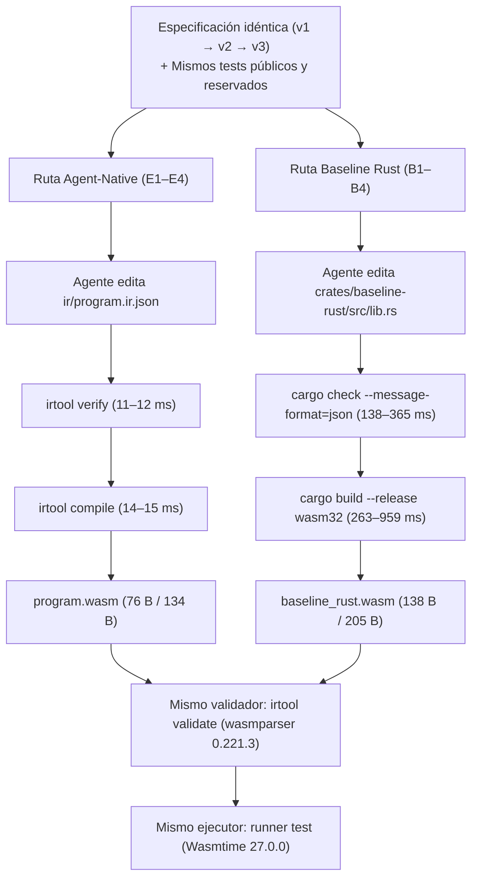

# Reporte de Benchmark Comparativo Pareado (`WI-008`)
## `Agent-Native (Semantic IR v0.1 → WASM)` vs `Baseline Tradicional (Rust → wasm32-unknown-unknown)`

- **ID de Experimento:** `KADDO-AGENT-NATIVE-POC-001`
- **Work Item:** `WI-008` (`KAN-POC-WI-008`)
- **Fecha:** `2026-10-16`
- **Conclusión de la POC:** `validated` (`Decision: GO`, `16/16` Success Criteria cumplidos)

---

## 1. Resumen Ejecutivo

Este reporte documenta los resultados empíricos del benchmark comparativo pareado entre dos rutas de construcción y evolución de software operadas por un agente para el mismo dominio de reglas comerciales puras (`calculate_shipping` y `calculate_discount`) compiladas a WebAssembly Core (`.wasm`) y evaluadas sobre el mismo runtime (`Wasmtime 27.0.0`):

1. **Ruta Agent-Native (`E1`–`E4`):** El agente mantiene exclusivamente un grafo semántico tipado (`ir/program.ir.json`, Semantic IR v0.1). Una micro-toolchain determinista congelada (`irtool verify` + `irtool compile`) verifica las invariantes semánticas y emite directamente el binario `.wasm`.
2. **Ruta Baseline Tradicional (`B1`–`B4`):** El agente mantiene código fuente en Rust (`crates/baseline-rust/src/lib.rs`, `#![no_std]`, `cdylib`) y utiliza el compilador estándar (`cargo check` / `cargo build --target wasm32-unknown-unknown --release` con `opt-level = "z"`, `lto = true`, `codegen-units = 1`, `panic = "abort"`, `strip = "symbols"`).

| Indicador Clave (KPI) | Ruta Agent-Native (`IR v0.1 → WASM`) | Baseline Rust (`Rust → wasm32-unknown-unknown`) | Ventaja Medida |
|---|---:|---:|---|
| **Tasa de aprobación de pruebas públicas (`M01`)** | `100 %` (`6/6`, `6/6`, `12/12`, `12/12`) | `100 %` (`6/6`, `6/6`, `12/12`, `12/12`) | Paridad funcional exacta (`100 %`) |
| **Tasa de aprobación de pruebas reservadas (`M02`)** | `100 %` (`9/9`, `9/9`, `18/18`, `18/18`) | `100 %` (`9/9`, `9/9`, `18/18`, `18/18`) | Paridad funcional exacta (`100 %`) |
| **Latencia de verificación (`verify` vs `cargo check`)** | **`11–12 ms`** | `138–365 ms` | **`12.5x` a `30.4x` más rápido** en Agent-Native |
| **Latencia de compilación (`.wasm` emitido)** | **`14–15 ms`** | `263–959 ms` (`396 ms` clean) | **`18.8x` a `63.9x` más rápido** en Agent-Native |
| **Ciclo completo determinista (`verify + compile`)** | **`25–27 ms`** | `401–1324 ms` | **`16.0x` a `49.0x` más rápido** en Agent-Native |
| **Tamaño del binario `.wasm` (`1` función: `E1`/`B1`)** | **`76 bytes`** | `138 bytes` | **`44.9 %` más pequeño** en Agent-Native |
| **Tamaño del binario `.wasm` (`2` funciones: `E3`/`B3`, `E4`/`B4`)** | **`134 bytes`** | `205 bytes` | **`34.6 %` más pequeño** en Agent-Native |
| **Tamaño del diagnóstico ante el mismo error (`E2` vs `B2`)** | **`264 bytes`** (`1` objeto JSON con JSONPath) | `6,158 bytes` (stream JSONL de `cargo check`) | **`23.3x` más compacto** (`-95.7 %` de ruido) |
| **Reproducibilidad binaria (`3/3` compilaciones en `E4`/`B4`)** | `3/3` SHA-256 idénticos | `3/3` SHA-256 idénticos | Paridad determinista (`3/3`) |

---

## 2. Metodología y Arquitectura del Benchmark Pareado

Ambas rutas fueron sometidas exactamente a la misma secuencia evolutiva de cuatro ejercicios bajo las mismas especificaciones (`spec/task.yaml` v1, v2 y v3) y las mismas suites de pruebas públicas y reservadas:



### Entorno controlado
- **Toolchain Rust:** `rustc 1.85.0 (4d91de4e4 2025-02-17)` / `cargo 1.85.0`
- **Target WASM:** `wasm32-unknown-unknown`
- **Runtime de evaluación:** `wasmtime 27.0.0` embebido en `crates/runner` (`sha256: 808cf7f6a6b88aedb141a2d09d75d999d3f36b8824aa1837b19113fb9963782c`)
- **Verifier/Compiler congelado (`poc-e1-freeze`):** `crates/irtool` (`sha256: 05b0d4c4d8bd85b5fcd7cbcfafa92dccb9b57d0a240464d50a5c874452604d0e`)

---

## 3. Resultados Detallados por Ejercicio Pareado

### 3.1. Par 1: Construcción Inicial (`E1` vs `B1` — `calculate_shipping` v1)

Regla implementada (`spec/task.yaml` v1):
- `SHIP-001`: Si `subtotal_cents < 0` → `-1`
- `SHIP-002`: Si `subtotal_cents >= 5000` → `0`
- `SHIP-003`: En cualquier otro caso → `500`

| Métrica | `E1` (Agent-Native IR v0.1) | `B1` (Baseline Rust `#![no_std]`) | Comparación |
|---|---:|---:|---|
| Tiempo de verificación (`M13`) | `12 ms` | `365 ms` | **`30.4x` más rápido** en Agent-Native |
| Tiempo de compilación (`M14`) | `15 ms` | `959 ms` | **`63.9x` más rápido** en Agent-Native |
| Tiempo total `verify + compile` | `27 ms` | `1,324 ms` | **`49.0x` más rápido** en Agent-Native |
| Tiempo de ejecución de tests públicos (`M15`) | `16 ms` | `11 ms` | Ambos `< 20 ms` |
| Tamaño del binario `.wasm` (`M16`) | `76 bytes` | `138 bytes` | **`44.9 %` más compacto** en Agent-Native |
| Pruebas públicas / reservadas | `6/6` / `9/9` | `6/6` / `9/9` | `100 %` en ambos |
| SHA-256 del `.wasm` | `026cbbc3...3dee505` | `41c67767...e29340` | Ambos válidos (`wasmparser`) |

---

### 3.2. Par 2: Diagnóstico y Reparación Controlada (`E2` vs `B2`)

En ambos ejercicios se inyectó exactamente el mismo defecto semántico en la primera condición de `calculate_shipping`: referenciar el identificador inexistente `subtotal` en lugar del parámetro `subtotal_cents`.

| Métrica | `E2` (Agent-Native `irtool verify`) | `B2` (Rust `cargo check --message-format=json`) | Comparación |
|---|---:|---:|---|
| Código de salida ante el defecto | `exit code = 1` | `exit code = 101` | Ambos rechazan determinísticamente |
| Código de diagnóstico emitido | `E_UNKNOWN_PARAM` | `E0425` | Específico de dominio vs genérico de lenguaje |
| Tiempo en detectar y emitir diagnóstico | **`11 ms`** | `181 ms` | **`16.5x` más rápido** en Agent-Native |
| Tamaño del archivo `diagnostics.injected.json` | **`264 bytes`** | `6,158 bytes` | **`23.3x` más pequeño** en Agent-Native |
| Localizador entregado al agente | `"$.functions[0].body.condition.left"` | `"src/lib.rs"`, `line_start: 11, column_start: 8` | Ruta lógica en el AST vs coordenadas de texto |
| Intentos de reparación (`M05`) | `1` | `1` | `1` intento en ambos |
| Tiempo de `verify + compile` tras reparar | **`25 ms`** (`11 + 14 ms`) | `401 ms` (`138 + 263 ms`) | **`16.0x` más rápido** en Agent-Native |

#### Comparación directa del diagnóstico recibido por el agente

- **Diagnóstico completo en Agent-Native (`E2`, `264 bytes` totales):**
  ```json
  [
    {
      "code": "E_UNKNOWN_PARAM",
      "function": "calculate_shipping",
      "path": "$.functions[0].body.condition.left",
      "message": "Unknown parameter 'subtotal'; available parameters: [\"subtotal_cents\"]",
      "expected": "subtotal_cents",
      "found": "subtotal"
    }
  ]
  ```
- **Diagnóstico en Baseline Rust (`B2`, `6,158 bytes` totales en stream JSONL):**
  Incluye mensajes `compiler-artifact` para dependencias internas, objeto `compiler-message` profundamente anidado con arreglos de `spans`, `children`, sugerencias de reemplazo basadas en offsets de bytes y un bloque `rendered` con secuencias de escape ANSI pensadas para una terminal humana.

---

### 3.3. Par 3: Extensión Funcional (`E3` vs `B3` — Adición de `calculate_discount`)

Regla añadida (`spec/task.yaml` v2) conservando `calculate_shipping`:
- `DISC-001`: Si `subtotal_cents < 0` → `-1`
- `DISC-002`: Si `premium == false` → `0`
- `DISC-003`: Si `premium == true` → `subtotal_cents / 10` (división entera con signo)

| Métrica | `E3` (Agent-Native IR v0.1) | `B3` (Baseline Rust `#![no_std]`) | Comparación |
|---|---:|---:|---|
| Tiempo de verificación (`M13`) | `11 ms` | `237 ms` | **`21.5x` más rápido** en Agent-Native |
| Tiempo de compilación (`M14`) | `14 ms` | `313 ms` | **`22.4x` más rápido** en Agent-Native |
| Tiempo total `verify + compile` | `25 ms` | `550 ms` | **`22.0x` más rápido** en Agent-Native |
| Tamaño del binario `.wasm` (`2` funciones) | **`134 bytes`** | `205 bytes` | **`34.6 %` más compacto** en Agent-Native |
| Pruebas públicas (`6` nuevas + `6` regresión) | `12/12` (`100 %`) | `12/12` (`100 %`) | `100 %` en ambos |
| Pruebas reservadas (`9` nuevas + `9` regresión) | `18/18` (`100 %`) | `18/18` (`100 %`) | `100 %` en ambos |
| Modificaciones al backend (`M07`) | `0` (`false`) | N/A | Toolchain congelado intacto |

---

### 3.4. Par 4: Mantenimiento Localizado y Reproducibilidad (`E4` vs `B4`)

Cambio de política en `calculate_shipping` (`spec/task.yaml` v3: envío gratuito desde `4000` en vez de `5000`, y tarifa de `600` en vez de `500`), manteniendo `calculate_discount` sin cambios.

| Métrica | `E4` (Agent-Native IR v0.1) | `B4` (Baseline Rust `#![no_std]`) | Comparación |
|---|---:|---:|---|
| Tiempo de verificación (`M13`) | `11 ms` | `188 ms` | **`17.1x` más rápido** en Agent-Native |
| Tiempo de compilación incremental / clean (`M14`) | `14 ms` | `320 ms` inc. / `396 ms` clean | **`22.9x`–`28.3x` más rápido** en Agent-Native |
| Tiempo total `verify + compile` | `25 ms` | `508 ms` inc. / `584 ms` clean | **`20.3x`–`23.4x` más rápido** en Agent-Native |
| Tamaño del binario `.wasm` (`M16`) | **`134 bytes`** | `205 bytes` | **`34.6 %` más compacto** en Agent-Native |
| Líneas modificadas en `diff.patch` (`M18`) | `3` líneas (`spec_version`, `4000`, `600`) | `3` líneas (comentario doc, `4000`, `600`) | Localidad idéntica (`3` líneas) |
| Reproducibilidad (`3/3` compilaciones, `M08`) | `3/3` (`947620fe...`) | `3/3` (`e840e0d1...`) | Ambos `100 %` deterministas |
| Pruebas públicas / reservadas | `12/12` / `18/18` (`100 %`) | `12/12` / `18/18` (`100 %`) | `100 %` en ambos |

---

## 4. Comparación Estructural de los Binarios `.wasm` Emitidos (`E4` vs `B4`)

Al desensamblar ambos binarios finales con `irtool print` (`wasmprinter`), se observa por qué el binario Agent-Native es **`34.6 %` a `44.9 %` más pequeño**:

### 4.1. WAT emitido por `irtool compile` (`E4` — `134 bytes`)
```wat
(module
  (type (;0;) (func (param i32) (result i32)))
  (type (;1;) (func (param i32 i32) (result i32)))
  (export "calculate_shipping" (func 0))
  (export "calculate_discount" (func 1))
  (func (;0;) (type 0) (param i32) (result i32)
    local.get 0
    i32.const 0
    i32.lt_s
    if (result i32) ;; label = @1
      i32.const -1
    else
      local.get 0
      i32.const 4000
      i32.ge_s
      if (result i32) ;; label = @2
        i32.const 0
      else
        i32.const 600
      end
    end
  )
  (func (;1;) (type 1) (param i32 i32) (result i32)
    local.get 0
    i32.const 0
    i32.lt_s
    if (result i32) ;; label = @1
      i32.const -1
    else
      local.get 1
      i32.const 0
      i32.eq
      if (result i32) ;; label = @2
        i32.const 0
      else
        local.get 0
        i32.const 10
        i32.div_s
      end
    end
  )
)
```

### 4.2. WAT emitido por `rustc --target wasm32-unknown-unknown -C opt-level=z` (`B4` — `205 bytes`)
```wat
(module
  (type (;0;) (func (param i32) (result i32)))
  (type (;1;) (func (param i32 i32) (result i32)))
  (memory (;0;) 16)
  (global (;0;) (mut i32) i32.const 1048576)
  (global (;1;) i32 i32.const 1048576)
  (global (;2;) i32 i32.const 1048576)
  (export "memory" (memory 0))
  (export "calculate_shipping" (func 0))
  (export "calculate_discount" (func 1))
  (export "__data_end" (global 1))
  (export "__heap_base" (global 2))
  (func (;0;) (type 0) (param i32) (result i32)
    i32.const 0
    i32.const 600
    local.get 0
    i32.const 3999
    i32.gt_u
    select
    i32.const -1
    local.get 0
    i32.const -1
    i32.gt_s
    select
  )
  (func (;1;) (type 1) (param i32 i32) (result i32)
    (local i32)
    i32.const 0
    local.set 2
    block ;; label = @1
      local.get 0
      i32.const 0
      i32.ge_s
      br_if 0 (;@1;)
      i32.const -1
      return
    end
    block ;; label = @1
      local.get 1
      i32.eqz
      br_if 0 (;@1;)
      local.get 0
      i32.const 10
      i32.div_u
      local.set 2
    end
    local.get 2
  )
)
```

---

## 5. Conclusiones del Benchmark (`WI-008`)

1. **Velocidad del bucle determinista (`16x` a `49x` más rápido):**
   En flujos agentic con verificación continua o búsqueda iterativa, reducir el ciclo `verify + compile` de `~500–1300 ms` a `25 ms` elimina el cuello de botella del compilador generalista (`rustc` + LLVM).
2. **Economía de contexto en diagnósticos (`23.3x` más compacto):**
   El diagnóstico de `irtool verify` (`264 B`) entrega directamente el nodo JSONPath (`$.functions[0].body.condition.left`) y los valores `expected`/`found`, ahorrando un `95.7 %` de bytes frente al stream JSONL de `cargo check` (`6,158 B`).
3. **Eliminación de fricción de ABI y trazabilidad verificada:**
   Mientras que en Rust el agente debe lidiar con `#![no_std]`, `#[panic_handler]`, `#[no_mangle]`, `extern "C"` y traducir `bool` manualmente a `i32`, la Semantic IR v0.1 mantiene tipos de dominio puros (`bool`, `i32`) y convierte la trazabilidad de requisitos (`requirements: ["SHIP-*", "DISC-*"]`) en una invariante verificada por el compilador (`E_MISSING_REQUIREMENT`).
4. **Higiene y mínima superficie del artefacto `.wasm` (`34.6 %`–`44.9 %` más pequeño):**
   El compilador directo `IR → WASM` emite únicamente las funciones puras solicitadas, sin reservar `1 MiB` de memoria lineal (`(memory 16)`) ni exportar símbolos de layout de memoria (`__data_end`, `__heap_base`) innecesarios.
