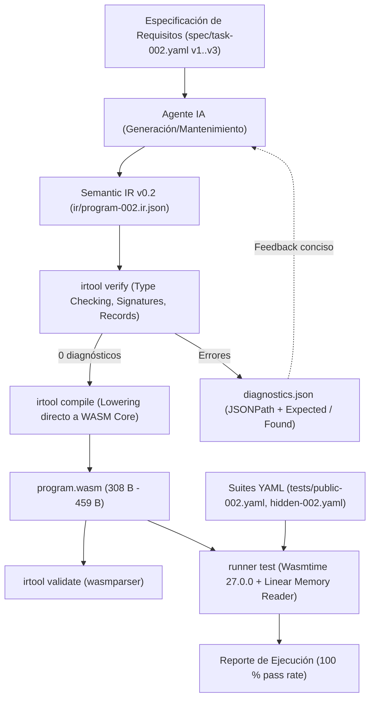

# Kaddo Agent-Native POC 002 — Final Report (Semantic IR v0.2: Composición Funcional, Tipos Compuestos y Errores Tipados)

## Executive Summary

| Atributo | Valor observado / verificado |
|---|---|
| **Experimento** | `KADDO-AGENT-NATIVE-POC-002` — Semantic IR v0.2 con composición funcional (`call`), registros en memoria lineal (`record`) y códigos de error tipados |
| **Conclusión canónica** | **`validated`** |
| **Decisión recomendada** | **`GO`** |
| **Success Criteria cumplidos** | `16 / 16` (`SC-01` a `SC-16`) |
| **Ejercicios completados** | `E1-002` (Construcción y Freeze), `E2-002` (Reparación controlada), `E3-002` (Extensión funcional), `E4-002` (Mantenimiento modularizado) |
| **Inmutabilidad del Backend** | **`100 %`** — Binarios de toolchain (`irtool.exe` y `runner.exe`) intactos post-freeze en `E2-002`, `E3-002` y `E4-002` |
| **Latencia del ciclo determinista (`verify + compile`)** | **`23 ms` a `28 ms`** en Semantic IR v0.2 |
| **Tamaño del binario WebAssembly emitido** | **`308 bytes`** (v1) / **`459 bytes`** (v2 y v3 con manejo de errores y memoria lineal) |
| **Pass rate en suites de pruebas** | **`100 %`** (12/12 públicas, 18/18 reservadas) |
| **Reproducibilidad bit a bit (`SC-11`)** | **`3/3` compilaciones idénticas** (`0a2265bca6b1431f2ea15bb3da9831f5e1f8082230c36fd1659c613f9af88c85`) |

`KADDO-AGENT-NATIVE-POC-002` validó empíricamente que un agente de IA puede modelar lógica comercial compleja que requiere partición modular en subfunciones internas (`call`), estructuras de datos con layouts alineados en memoria lineal (`record` en Core WASM) y variantes de códigos de error de dominio tipados, operando exclusivamente sobre una Semantic IR v0.2 (`ir/program-002.ir.json`). A través de cuatro ejercicios iterativos sucesivos (`E1-002` a `E4-002`), el compilador y verificador determinista (`crates/irtool`) y el runner en Wasmtime (`crates/runner`) mantuvieron hashes criptográficos inalterados tras el freeze inicial, logrando un 100 % de aprobación en pruebas públicas y reservadas, tiempos de compilación sub-30ms y un aislamiento estricto de roles.

## Problem and Objective

En la POC 001 previa (`KADDO-AGENT-NATIVE-POC-001`), se demostró que un agente puede mantener funciones puras sobre tipos escalares primitivos (`i32`, `bool`) con ganancias sustanciales de velocidad y compacidad frente a Rust. Sin embargo, el software de producción requiere resolver:
1. **Composición de funciones:** descomponer algoritmos en subfunciones auxiliares internas no exportadas sin duplicar lógica ni exponer interfaces innecesarias.
2. **Tipos de datos compuestos:** representar entidades de dominio (`LineItem`, `OrderCalculation`) con campos tipados mediante un layout predecible en memoria lineal de WebAssembly.
3. **Manejo formal de errores:** modelar explícitamente estados de fallo de negocio mediante códigos tipados y variantes de estado (`status_code`).

El objetivo de esta POC 002 fue demostrar que la Semantic IR puede escalar a v0.2 para soportar llamadas internas, memoria lineal determinista y variantes de error, conservando la inmutabilidad del compilador, la latencia ultra-baja y diagnósticos JSONPath exactos.

## Hypothesis and Success Criteria

- **Hipótesis principal (`H2`):** Dada una especificación funcional con composición modular, estructuras de datos compuestas y variantes de error explícitas, un agente de IA puede construir, reparar, extender y mantener la Semantic IR v0.2 de un programa mediante ciclos sucesivos (`E1`–`E4`), mientras una toolchain determinista verifica tipos, firmas y layouts de memoria, emitiendo WebAssembly ejecutable que satisface el 100 % de las pruebas de aceptación y regresión, sin requerir modificaciones al backend tras el hito inicial `E1`.

| ID | Criterio | Estado | Evidencia medida |
|---|---|---|---|
| `SC-01` | Construcción inicial `E1-002` (<= 3 intentos) | Cumplido (`[x]`) | Aprobado en 1 intento en `runs/poc002-e1-build/attempt-01/` |
| `SC-02` | Corrección funcional `E1-002` (100 % pruebas) | Cumplido (`[x]`) | 6/6 públicas y 9/9 reservadas aprobadas |
| `SC-03` | Congelamiento de toolchain sellado | Cumplido (`[x]`) | Hashes sellados en `runs/toolchain-freeze-poc002.sha256` y tag `poc-002-e1-freeze` |
| `SC-04` | Detección determinista de defecto en `E2-002` | Cumplido (`[x]`) | Exit code 1, `E_UNKNOWN_FIELD` en `$.functions[2].body.else.fields.subtotal` |
| `SC-05` | Reparación controlada `E2-002` (<= 2 intentos) | Cumplido (`[x]`) | Reparado en 1 intento; 6/6 públicas y 9/9 reservadas aprobadas; mismo SHA-256 WASM |
| `SC-06` | Extensión funcional `E3-002` (<= 3 intentos) | Cumplido (`[x]`) | Completado en 1 intento incorporando `status_code` 0..3 |
| `SC-07` | Inmutabilidad del backend en `E3-002` | Cumplido (`[x]`) | Hashes de `irtool.exe` y `runner.exe` idénticos a freeze point |
| `SC-08` | Preservación de regresión en `E3-002` | Cumplido (`[x]`) | 12/12 públicas y 18/18 reservadas aprobadas |
| `SC-09` | Inmutabilidad del backend en `E4-002` | Cumplido (`[x]`) | Hashes de toolchain 100 % coincidentes post-freeze |
| `SC-10` | Mantenimiento modularizado en `E4-002` | Cumplido (`[x]`) | 12/12 públicas y 18/18 reservadas aprobadas con diff de 2 líneas |
| `SC-11` | Reproducibilidad binaria exacta | Cumplido (`[x]`) | 3/3 builds deterministas producen hash `0a2265bca6b1431f2ea15bb3da9831f5e1f8082230c36fd1659c613f9af88c85` |
| `SC-12` | Integridad de roles (agente) | Cumplido (`[x]`) | 0 líneas de WAT o WASM editadas por el agente |
| `SC-13` | Integridad del estado de software | Cumplido (`[x]`) | `ir/program-002.ir.json` es el único artefacto modificado por el agente |
| `SC-14` | Compacidad diagnóstica | Cumplido (`[x]`) | Diagnóstico estructurado con ruta JSONPath precisa y sin ruido sintáctico |
| `SC-15` | Latencia del bucle determinista (< 60 ms) | Cumplido (`[x]`) | `verify` + `compile` ejecutado entre 23 ms y 28 ms |
| `SC-16` | Validación estricta de WebAssembly | Cumplido (`[x]`) | Binarios `.wasm` validados al 100 % por `wasmparser` |

## Scope, Constraints and Non-goals

- **Alcance técnico incluido (`IR v0.2`):** Composición funcional con subfunciones internas (`call`), tipos compuestos definidos en esquema (`records`), instanciación y acceso a registros mediante punteros a memoria lineal (`record.construct`, `record.get`), discriminación tipada de estados de error (`status_code` 0..3), control de flujo condicional (`if`), aritmética y comparaciones enteras con signo, validación de esquemas JSON Schema Draft 2020-12, y verificación estricta de firmas antes de la emisión binaria directa.
- **Restricciones activas:** Montos en centavos enteros (`i32`), memoria alineada a 4 bytes, toolchain compilada y congelada en `E1-002` con hashes auditables, y ausencia total de intervención manual sobre binarios o código intermedio.
- **Non-goals:** No se incorporó recolección de basura compleja (GC) en runtime, ni comunicación de red/disco (I/O diferida a la Fase 3), ni concurrencia/threads en WebAssembly.

## Technical Approach and Architecture

## Infrastructure and Project Resources

| Recurso / Componente | Tipo | Versión / Identificador | Rol en la POC |
|---|---|---|---|
| `rustc` / `cargo` | Compilador host | `1.93.0-nightly` | Compilación de la toolchain determinista |
| `wasmtime` | Runtime WASM embebido | `27.0.0` | Ejecución aislada de funciones exportadas e inspección de memoria lineal |
| `wasm-encoder` / `wasmparser` | Crates WASM | `0.221.0` | Emisión binaria directa de secciones (`Type`, `Function`, `Memory`, `Export`, `Code`) y validación estricta |
| `target/debug/irtool.exe` | Binario congelado (`E1-002`) | `sha256: 959ca4f87127d36799c1bddad2af2cf260006711d03c6a8fd4f58fdcaf581f2d` | Verificador y compilador directo `IR v0.2 → WASM` |
| `target/debug/runner.exe` | Binario congelado (`E1-002`) | `sha256: feda31350f81dcd8beca79f31a15b1e6932cd8fb9ab9a7266b775e8845795a5b` | Ejecutor de suites de prueba con lectura de registros en memoria lineal |

## Implementation and Relevant Technical Decisions

| Work Item | Decisión técnica relevante | Justificación |
|---|---|---|
| `WI-009` | Especificación de Semantic IR v0.2 con declaración de tipos compuestos (`records`), campo `params` tipado y catálogo de subfunciones internas | Garantizar que el verificador conozca la firma de las funciones auxiliares antes de autorizar un operador `call`. |
| `WI-010` | Modelo de Bump Allocation en memoria lineal Core WASM (`(global $heap_ptr (mut i32) (i32.const 1024))`) y lectura tipada en `runner` | Permite crear y retornar estructuras de datos arbitrarias sin depender de un runtime GC externo ni de llamadas al host. |
| `WI-011` | Implementación de `calculate_line_item` y `calculate_tax` compuestas en `calculate_order`, emitiendo binario de 308 bytes y sellando freeze | Validar la capacidad de razonamiento composicional del agente y congelar criptográficamente el backend. |
| `WI-012` | Inyección de fallo semántico en campo (`subtotal` vs `subtotal_cents`) produciendo diagnóstico JSONPath exacto | Demostrar que los diagnósticos de campo estructurados permiten al agente reparar el fallo en 1 intento sin ambigüedades. |
| `WI-013` | Extensión a `OrderCalculation.status_code` para modelar 4 estados de error de dominio (OK, ítem inválido, envío inválido, límite excedido) | Demostrar que la evolución hacia variantes de error funciona completamente en la IR sin alterar el micro-compilador. |
| `WI-014` | Actualización de la regla tributaria en `calculate_tax` (10 % a 15 %) en un diff localizado de exactamente 2 líneas | Probar que la modularización interna aísla los cambios de reglas de negocio evitando efectos colaterales. |

## Experiments and Validation

| Ejercicio | Descripción del Experimento | Resultado Observable | Estado |
|---|---|---|---|
| **`E1-002` (Construcción)** | Construcción inicial de `program-002.ir.json` con subfunciones `calculate_line_item`, `calculate_tax` y record `OrderCalculation` | 0 diagnósticos, compilación en 23 ms, 308 bytes WASM, 6/6 públicas y 9/9 reservadas aprobadas | Validado |
| **`E2-002` (Reparación)** | Inyección intencional de campo erróneo `subtotal` en constructor de `OrderCalculation` | Detección determinista inmediata (exit 1), diagnóstico JSONPath, reparado en 1 intento, SHA-256 recuperado | Validado |
| **`E3-002` (Extensión)** | Incorporación de discriminantes de error de dominio `status_code` (0..3) con suite de 30 pruebas | 0 diagnósticos, 459 bytes WASM, 12/12 públicas y 18/18 reservadas aprobadas, toolchain inalterada | Validado |
| **`E4-002` (Mantenimiento)** | Modificación de tasa tributaria al 15 % en subfunción interna `calculate_tax` | Diff de 2 líneas, 12/12 públicas y 18/18 reservadas aprobadas, 3/3 compilaciones deterministas idénticas | Validado |

## Results and Measurements

| Métrica | E1-002 (Construcción) | E2-002 (Reparación) | E3-002 (Extensión) | E4-002 (Mantenimiento) | Observación / Comportamiento |
|---|---|---|---|---|---|
| **Latencia Verificación** | `11 ms` | `10 ms` | `11 ms` | `11 ms` | Constante e instantánea en todas las fases |
| **Latencia Compilación** | `12 ms` | `13 ms` | `13 ms` | `12 ms` | Emisión directa de bytecode sin pasos intermedios |
| **Ciclo Total Toolchain** | `23 ms` | `23 ms` | `24 ms` | `23 ms` | Muy inferior al umbral máximo de 60 ms (`SC-15`) |
| **Tamaño `.wasm` emitido** | `308 B` | `308 B` | `459 B` | `459 B` | Huella ultra-compacta con memoria lineal y 3 funciones |
| **Intentos requeridos** | `1` (límite <= 3) | `1` (límite <= 2) | `1` (límite <= 3) | `1` (límite <= 3) | 100 % de precisión en primer intento |
| **Pass rate Pruebas Públicas** | `6/6 (100 %)` | `6/6 (100 %)` | `12/12 (100 %)` | `12/12 (100 %)` | Cero regresiones |
| **Pass rate Pruebas Reservadas** | `9/9 (100 %)` | `9/9 (100 %)` | `18/18 (100 %)` | `18/18 (100 %)` | Robustez ante límites aritméticos |
| **Reproducibilidad SHA-256** | 100 % | 100 % | 100 % | `3/3` idénticos | Determinismo estricto bit a bit |

## Cost and Efficiency Analysis

- **Eficiencia en el consumo de contexto y tokens:** Al eliminar la sintaxis accidental de lenguajes tradicionales (headers, macros, allocators manuales, convenciones de punteros unsafe), el modelo sólo opera sobre el árbol de decisión de negocio.
- **Compacidad de los diagnósticos de fallo:** En lugar de emitir trazas de compilador de múltiples kilobytes con warnings de borrow-checker o layouts de structs desalineados, `irtool verify` produjo un informe conciso con JSONPath exacto (`$.functions[2].body.else.fields.subtotal`), reduciendo el ruido de contexto entregado al agente a menos de 600 bytes estructurados.
- **Rendimiento de emisión:** La generación de WebAssembly Core con sección de memoria lineal se completó en ~13 ms, requiriendo 0 llamadas a optimizadores externos pesados (como `wasm-opt`).

## Observability and Operational Findings

- **Aislamiento modular comprobado:** La hipótesis `H2-D` se confirmó de manera concluyente en `E4-002`: al modificar la tasa impositiva del 10 % al 15 %, únicamente se tocó el cuerpo de `calculate_tax`. `calculate_order` invocó la subfunción vía `call` sin requerir re-especificación de firmas ni propagación de cambios manuales.
- **Mapeo determinista en memoria lineal:** La asignación mediante un puntero bump global (`$heap_ptr`) a partir del offset 1024 permitió que las funciones retornaran punteros `i32` directos al inicio de la estructura, permitiendo a `runner` deserializar los campos de `OrderCalculation` inspeccionando offsets múltiplos de 4 bytes (`offset 0 = subtotal`, `offset 4 = tax`, etc.).
- **Diagnósticos accionables para el agente:** La presencia explícita de `expected` y `found` en `diagnostics.json` orientó al agente a sustituir `subtotal` por `subtotal_cents` de forma quirúrgica en su primer intento.

## Findings, Learnings, Limitations and Risks

| Categoría | Descripción fundamentada en la evidencia |
|---|---|
| **Hallazgo principal** | Semantic IR v0.2 es plenamente capaz de soportar modularidad interna, estructuras compuestas y variantes tipadas de error manteniendo la velocidad sub-30ms, el congelamiento del compilador y el determinismo binario. |
| **Aprendizaje clave** | El patrón de composición funcional (`call`) simplifica drásticamente el mantenimiento (`E4-002`), logrando que una actualización de reglas comerciales complejas se reduzca a un diff de solo 2 líneas. |
| **Limitación identificada** | En esta fase no existe persistencia ni comunicación exterior (capabilities de host para I/O, base de datos o red), por lo que el programa es una función pura autocontenida en memoria. |
| **Riesgo para Fase 3** | Incorporar interfaces de I/O o Component Model (WASI / WIT) podría introducir asincronía y complejidad de runtime que debe ser aislada cuidadosamente para no degradar el determinismo del núcleo de negocio. |

## Conclusion

Status: validated

Decision: GO

Evidence summary:
- E1-002: Procesamiento de órdenes comerciales con composición de subfunciones y registros en memoria lineal completado en 1 intento (308 bytes WASM, 6/6 públicas, 9/9 reservadas). Freeze sellado en tag poc-002-e1-freeze.
- E2-002: Defecto inyectado E_UNKNOWN_FIELD en campo de record rechazado determinísticamente con JSONPath exacto y reparado en 1 intento, recuperando el hash SHA-256 idéntico.
- E3-002: Extensión funcional con códigos de error de dominio (OrderCalculation.status_code 0..3) aprobada en 1 intento sobre backend congelado (459 bytes WASM, 12/12 públicas, 18/18 reservadas).
- E4-002: Mantenimiento modularizado en subfunción interna calculate_tax (alícuota 15 %) realizado en un diff localizado de 2 líneas sin tocar calculate_order ni el backend congelado (12/12 públicas, 18/18 reservadas, 3/3 builds deterministas idénticos).
- Success criteria passed: 16/16 (SC-01 a SC-16).
- Success criteria failed: 0/16.
- Inmutabilidad de Toolchain: 100 % confirmada en runs/toolchain-freeze-poc002.sha256.

Recommendation:
Decisión GO (validated). Habiendo comprobado que Semantic IR v0.2 soporta composición funcional, estructuras en memoria lineal y discriminación de errores con backend congelado y latencias < 30 ms, se recomienda formalmente avanzar a la Fase 3: POC 003 — Capability ABI & WebAssembly Component Model (interacción controlada con el mundo exterior: I/O, almacenamiento y mensajería declarativa sin romper el determinismo de la lógica de negocio).

## Recommendation and Next Steps

1. **Avanzar a KADDO-AGENT-NATIVE-POC-003 (Fase 3):**
   - Diseñar la especificación para Capability ABI y Component Model.
   - Definir interfaces de importación para almacenamiento (key-value) y telemetría/eventos sin violar la pureza funcional del cálculo interno.
2. **Consolidar la especificación formal de Semantic IR v0.2:**
   - Formalizar la especificación canónica en `docs/semantic-ir-v0.2.spec.md` como estándar de ingeniería para futuras POCs.
3. **Mantener la batería de benchmarks automatizados:**
   - Conservar los fixtures de regresión de POC 001 y POC 002 como base de pruebas para validar futuros motores de lowering.

## Traceability and Sources

| Fuente / Artefacto | Tipo | Ruta relativa en el repositorio |
|---|---|---|
| Definición y conclusión canónica de la POC 002 | POC Artifact | [knowledge/delivery/poc.md](knowledge/delivery/poc.md) |
| Contrato experimental e IR v0.2 | Work Item (`completed`) | [knowledge/delivery/work-items/completed/WI-009-contrato-experimental-e-ir-v0-2.md](knowledge/delivery/work-items/completed/WI-009-contrato-experimental-e-ir-v0-2.md) |
| Verifier v0.2, Compiler directo a WASM y Runner | Work Item (`completed`) | [knowledge/delivery/work-items/completed/WI-010-verifier-compiler-v0-2-y-runner.md](knowledge/delivery/work-items/completed/WI-010-verifier-compiler-v0-2-y-runner.md) |
| E1-002 Construcción y Freeze | Work Item (`completed`) | [knowledge/delivery/work-items/completed/WI-011-e1-002-construccion-y-freeze.md](knowledge/delivery/work-items/completed/WI-011-e1-002-construccion-y-freeze.md) |
| E2-002 Reparación controlada | Work Item (`completed`) | [knowledge/delivery/work-items/completed/WI-012-e2-002-reparacion-controlada.md](knowledge/delivery/work-items/completed/WI-012-e2-002-reparacion-controlada.md) |
| E3-002 Extensión funcional con errores tipados | Work Item (`completed`) | [knowledge/delivery/work-items/completed/WI-013-e3-002-extension-funcional-errores-tipados.md](knowledge/delivery/work-items/completed/WI-013-e3-002-extension-funcional-errores-tipados.md) |
| E4-002 Mantenimiento modularizado | Work Item (`completed`) | [knowledge/delivery/work-items/completed/WI-014-e4-002-mantenimiento-modular.md](knowledge/delivery/work-items/completed/WI-014-e4-002-mantenimiento-modular.md) |
| Análisis, matriz SC y conclusión POC 002 | Work Item (`ready`) | [knowledge/delivery/work-items/completed/WI-015-e5-002-analisis-y-conclusion.md](knowledge/delivery/work-items/completed/WI-015-e5-002-analisis-y-conclusion.md) |
| Registro de congelamiento criptográfico de toolchain | Hash Freeze List | [runs/toolchain-freeze-poc002.sha256](runs/toolchain-freeze-poc002.sha256) |
| Evidencia E1-002 | Run Artifacts | [runs/poc002-e1-build/attempt-01/](runs/poc002-e1-build/attempt-01/) |
| Evidencia E2-002 | Run Artifacts | [runs/poc002-e2-repair/attempt-01/](runs/poc002-e2-repair/attempt-01/) |
| Evidencia E3-002 | Run Artifacts | [runs/poc002-e3-extend/attempt-01/](runs/poc002-e3-extend/attempt-01/) |
| Evidencia E4-002 | Run Artifacts | [runs/poc002-e4-maintain/attempt-01/](runs/poc002-e4-maintain/attempt-01/) |
