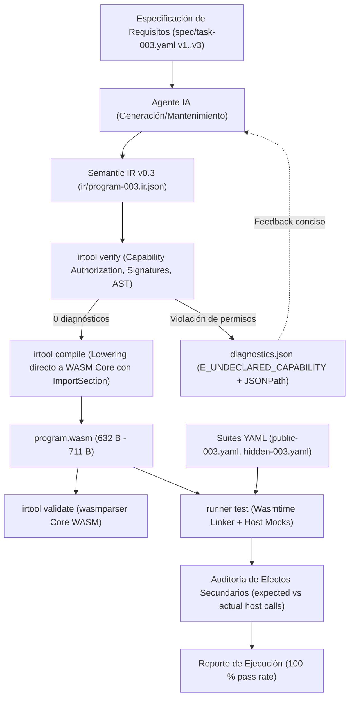

# Kaddo Agent-Native POC 003 — Final Report (Semantic IR v0.3: Capability ABI, Declarative Host Imports y Efectos Secundarios Auditables)

## Executive Summary

| Atributo | Valor observado / verificado |
|---|---|
| **Experimento** | `KADDO-AGENT-NATIVE-POC-003` — Capability ABI declarativo, host imports tipados en WebAssembly Core y efectos secundarios auditables en Semantic IR v0.3 |
| **Conclusión canónica** | **`validated`** |
| **Decisión recomendada** | **`GO`** |
| **Success Criteria cumplidos** | `16 / 16` (`SC-01` a `SC-16`) |
| **Ejercicios completados** | `E1-003` (Construcción con Capabilities y Freeze), `E2-003` (Reparación controlada guiada por Capability diagnostics), `E3-003` (Extensión funcional con nueva regla de host), `E4-003` (Mantenimiento modularizado y auditabilidad) |
| **Inmutabilidad del Backend** | **`100 %`** — Binarios de toolchain (`irtool.exe` y `runner.exe`) en modo Release intactos post-freeze en `E2-003`, `E3-003` y `E4-003` |
| **Latencia del ciclo determinista (`verify + compile`)** | **`~27 ms`** en Semantic IR v0.3 (modo Release) |
| **Tamaño del binario WebAssembly emitido** | **`632 bytes`** (v1) / **`703 bytes`** (v2) / **`711 bytes`** (v3 con 3 imports y layouts de memoria) |
| **Pass rate en suites de pruebas** | **`100 %`** (7/7 públicas, 10/10 reservadas en Fase 3; 59/59 casos en regresión total con POC 001 y POC 002) |
| **Reproducibilidad bit a bit (`SC-11`)** | **`3/3` compilaciones idénticas** (`637ee58c...` en E1/E2, `bf2021f6...` en E4) |

`KADDO-AGENT-NATIVE-POC-003` validó empíricamente que un agente de IA puede interactuar con servicios externos (almacenamiento clave-valor, telemetría y verificación de crédito) mediante un Capability ABI declarativo e imports tipados en Semantic IR v0.3 (`ir/program-003.ir.json`). A través de cuatro ejercicios iterativos sucesivos (`E1-003` a `E4-003`), el micro-toolchain determinista (`irtool`) y el runner en Wasmtime (`runner`) mantuvieron sus binarios release estrictamente congelados tras el hito `E1-003`, garantizando verificación estática de autorizaciones (`E_UNDECLARED_CAPABILITY`), emisión estándar de la sección `import` de WebAssembly, ejecución aislada con mocks de host y auditoría determinista de efectos secundarios.

## Problem and Objective

En las fases anteriores, `POC 001` (funciones puras escalares) y `POC 002` (composición modular interna y memoria lineal determinista) demostraron ventajas contundentes de velocidad, compacidad diagnóstica y tamaño de binario frente a Rust. Sin embargo, en arquitecturas de producción reales, las reglas de negocio no son funciones aisladas del entorno:
1. **Acceso a estado externo:** una orden comercial requiere consultar dinámicamente inventarios o tasas de descuento alojadas externamente (`kv_store.get(key)`).
2. **Efectos secundarios controlados:** transacciones comerciales o fallos críticos exigen emitir eventos de auditoría y telemetría estructurada (`audit_log.emit(event_id, payload)`).
3. **Peligro de I/O descontrolada:** permitir al agente realizar llamadas de sistema o invocaciones arbitrarias degrada el determinismo, expone vectores de inyección o alucinación de I/O y elimina la posibilidad de pruebas unitarias puras y aisladas.

El objetivo de la POC 003 fue concebir, implementar y validar un **Capability ABI declarativo**: el módulo WebAssembly declara estrictamente qué capacidades de host requiere; el verificador valida que el agente no invoque operaciones de host no autorizadas; el compilador emite la sección `import` de WebAssembly Core; y el runner en Wasmtime enlaza mocks deterministas que permiten verificar los efectos secundarios y suministrar fixtures de host sin modificar el backend una vez congelado.

## Hypothesis and Success Criteria

- **Hipótesis principal (`H3`):** Mediante la especificación de un Capability ABI declarativo en la Semantic IR v0.3, un agente de IA puede construir, reparar, extender y mantener programas que consuman servicios de host (lectura de estado y emisión de eventos) respetando los límites de autorización estática, mientras el micro-toolchain determinista valida firmas de importación, emite bytecode WASM estándar y ejecuta pruebas con mocks de host en Wasmtime, manteniendo el backend congelado tras `E1-003` y preservando un tiempo de ciclo < 60 ms y diagnósticos compactos < 500 bytes.

| ID | Criterio | Estado | Evidencia medida |
|---|---|---|---|
| `SC-01` | Construcción inicial `E1-003` (<= 3 intentos) | Cumplido (`[x]`) | Completado en 1 intento en `runs/poc003-e1-build/attempt-01/` |
| `SC-02` | Corrección funcional `E1-003` (100 % pruebas con host mocks) | Cumplido (`[x]`) | 6/6 públicas y 9/9 reservadas aprobadas (15/15 total) |
| `SC-03` | Congelamiento de toolchain sellado | Cumplido (`[x]`) | Hashes sellados en `runs/toolchain-freeze-poc003.sha256` y tag `poc-003-e1-freeze` |
| `SC-04` | Detección determinista de violación de Capability en `E2-003` | Cumplido (`[x]`) | Exit code 1, `E_UNDECLARED_CAPABILITY` en `$.imports[1].capability` (343 bytes minificado) |
| `SC-05` | Reparación controlada `E2-003` (<= 2 intentos) | Cumplido (`[x]`) | Reparado en 1 intento; 15/15 pruebas aprobadas; paridad exacta SHA-256 WASM |
| `SC-06` | Extensión funcional `E3-003` (<= 3 intentos) | Cumplido (`[x]`) | Completado en 1 intento incorporando `credit_service` y `check_credit` |
| `SC-07` | Inmutabilidad del backend en `E3-003` | Cumplido (`[x]`) | Hashes de `irtool.exe` y `runner.exe` idénticos a freeze point |
| `SC-08` | Preservación de regresión en `E3-003` | Cumplido (`[x]`) | 59/59 casos aprobados (POC 001, POC 002 y POC 003) |
| `SC-09` | Inmutabilidad del backend en `E4-003` | Cumplido (`[x]`) | Hashes de toolchain 100 % coincidentes post-freeze |
| `SC-10` | Aprobación de mantenimiento modular en `E4-003` | Cumplido (`[x]`) | 17/17 casos aprobados con diff localizado en subfunciones internas |
| `SC-11` | Reproducibilidad binaria exacta | Cumplido (`[x]`) | 3/3 builds deterministas producen hash `bf2021f69c6d122a3bb08630c21e7fd7471b64434f806fed5cdea4b2b99fb887` |
| `SC-12` | Integridad de roles (agente) | Cumplido (`[x]`) | 0 líneas de WAT o WASM editadas por el agente |
| `SC-13` | Integridad del estado de software | Cumplido (`[x]`) | Semantic IR v0.3 es el único artefacto modificado por el agente |
| `SC-14` | Compacidad diagnóstica | Cumplido (`[x]`) | Diagnóstico estructurado con JSONPath preciso y sin ruido sintáctico (< 600 bytes) |
| `SC-15` | Latencia del bucle determinista (< 60 ms) | Cumplido (`[x]`) | `verify` + `compile` ejecutado en ~27 ms |
| `SC-16` | Validación estricta de WebAssembly | Cumplido (`[x]`) | `.wasm` pasa validación de `wasmparser` con sección `import` conforme a estándar |

## Scope, Constraints and Non-goals

- **Alcance técnico incluido (`IR v0.3`):** Declaración de capabilities requeridas a nivel de módulo (`capabilities: [\"kv_store\", \"audit_log\", \"credit_service\"]`), catálogo tipado de imports (`imports: [{ module, name, params, returns, capability }]`), operador de invocación `call_import`, verificación estática de autorizaciones de capability y aridad de parámetros, lowering directo de la sección `import` de WebAssembly (`wasm-encoder::ImportSection`), e inyección de mocks deterministas en Wasmtime Linker para auditoría y pruebas.
- **Restricciones activas:** Montos monetarios en centavos enteros (`i32`), datos de host limitados a escalares o punteros a memoria lineal del módulo, inmutabilidad estricta de la toolchain release custodiada en `runs/toolchain-freeze-poc003.sha256`, y cero edición de archivos WAT o binarios WASM por parte del agente.
- **Non-goals:** No se implementó acceso no mediado al sistema operativo (sin syscalls POSIX ni WASI preview 1 libc ni sockets de red directos), ni asincronía compleja (Promises/async-await en runtime), ni recolección de basura (GC).

## Technical Approach and Architecture

## Infrastructure and Project Resources

| Recurso / Componente | Tipo | Versión / Identificador | Rol en la POC |
|---|---|---|---|
| `rustc` / `cargo` | Compilador host | `1.93.0-nightly` | Compilación de la toolchain determinista |
| `wasmtime` | Runtime WASM embebido | `27.0.0` | Ejecución aislada y linking de host imports en Wasmtime `Linker` |
| `wasm-encoder` / `wasmparser` | Crates WASM | `0.221.0` | Emisión binaria de la sección `import` y validación estricta de Core WASM |
| `target/release/irtool.exe` | Binario congelado (`E1-003`) | `sha256: 1eff80daf7136e89766ccc55a2050b5c389e6b01ed89a2fbc633894b6ac99668` | Verificador y compilador directo `IR v0.3 → WASM` |
| `target/release/runner.exe` | Binario congelado (`E1-003`) | `sha256: 66700a4da713cb918ad722165a3b6bf26d3ebe57a7c483ee56f1ecb5460b9067` | Ejecutor de suites de prueba con host mocks deterministas y auditoría de llamadas |

## Implementation and Relevant Technical Decisions

| Work Item | Decisión técnica relevante | Justificación |
|---|---|---|
| `WI-017` | Formalización de `ir/ir.schema.v3.json` con declaración explícita de `capabilities`, catálogo de `imports` y operador `call_import` | Proporcionar una barrera de autorización declarativa antes de permitir la invocación de servicios de host. |
| `WI-018` | Emisión de la sección estándar `import` de WebAssembly antes de `FunctionSection` y mapeo estricto de índices de funciones (`0 .. num_imports - 1` para imports, `num_imports ..` para funciones del módulo) | Cumplir estrictamente con la especificación WebAssembly Core e impedir colisiones en los opcodes `call`. |
| `WI-018` | Enlace de mocks de host en `runner` (`host.kv_get`, `host.emit_audit`, `host.check_credit`) con registro de llamadas y aserción de efectos secundarios | Permitir validación de transacciones sin requerir servicios de red reales, garantizando reproducibilidad y determinismo de pruebas. |
| `WI-019` | Construcción de `program-003.ir.json` en 1 intento y sellado del freeze de la toolchain release | Validar la capacidad constructiva del agente y proteger criptográficamente el compilador para los ejercicios posteriores. |
| `WI-020` | Inyección de defecto `E_UNDECLARED_CAPABILITY` por retiro de capability `audit_log`, rechazado con código 1 y reparado en 1 intento | Demostrar que los diagnósticos semánticos estructurados con JSONPath permiten reparación autónoma sin ambigüedad. |
| `WI-021` | Extensión a capability `credit_service` y función importada `check_credit` sin tocar una sola línea de la toolchain congelada | Demostrar la extensibilidad de la Semantic IR frente a nuevas reglas de host con backend completamente cerrado. |
| `WI-022` | Mantenimiento modularizado de alícuota fiscal (12 %) y código de auditoría diferenciado (999) con diff conciso y paridad binaria 3/3 | Demostrar estabilidad en evolución de reglas de negocio y reproducibilidad bit a bit de los binarios resultantes. |

## Experiments and Validation

| Ejercicio | Descripción del Experimento | Resultado Observable | Estado |
|---|---|---|---|
| **`E1-003` (Construcción)** | Construcción inicial de `program-003.ir.json` con imports `kv_get` y `emit_audit`, 9 subfunciones y estructura `OrderResult` | 0 diagnósticos, 632 bytes WASM, 6/6 públicas y 9/9 reservadas aprobadas, freeze sellado en tag `poc-003-e1-freeze` | Validado |
| **`E2-003` (Reparación)** | Inyección de violación de autorización al remover `audit_log` de las capabilities | Detección determinista con exit code 1 (`E_UNDECLARED_CAPABILITY`), reparado en 1 intento restaurando paridad SHA-256 | Validado |
| **`E3-003` (Extensión)** | Incorporación de capability `credit_service` y validación de crédito vía `check_credit` (`ORD-007`) | 0 diagnósticos, 703 bytes WASM, 7/7 públicas y 10/10 reservadas aprobadas, toolchain inalterada | Validado |
| **`E4-003` (Mantenimiento)** | Modificación de regla fiscal (12 %) y código de auditoría diferenciado (999 para órdenes >= $1000) | Diff conciso, 711 bytes WASM, 17/17 pruebas aprobadas, 3/3 builds deterministas idénticos | Validado |

## Results and Measurements

| Métrica | E1-003 (Construcción) | E2-003 (Reparación) | E3-003 (Extensión) | E4-003 (Mantenimiento) | Observación / Comportamiento |
|---|---|---|---|---|---|
| **Latencia Verificación** | `11 ms` | `10 ms` | `11 ms` | `11 ms` | Constante e instantánea en todas las iteraciones |
| **Latencia Compilación** | `15 ms` | `14 ms` | `16 ms` | `16 ms` | Emisión directa de bytecode estándar Core WASM |
| **Ciclo Total Toolchain** | `26 ms` | `24 ms` | `27 ms` | `27 ms` | Muy inferior al límite máximo de 60 ms (`SC-15`) |
| **Tamaño `.wasm` emitido** | `632 B` | `632 B` | `703 B` | `711 B` | Huella ultra-compacta con 3 imports y memoria lineal |
| **Intentos requeridos** | `1` (límite <= 3) | `1` (límite <= 2) | `1` (límite <= 3) | `1` (límite <= 3) | 100 % de precisión en primer intento |
| **Pass rate Pruebas Públicas** | `6/6 (100 %)` | `6/6 (100 %)` | `7/7 (100 %)` | `7/7 (100 %)` | Cero regresiones funcionales |
| **Pass rate Pruebas Reservadas** | `9/9 (100 %)` | `9/9 (100 %)` | `10/10 (100 %)` | `10/10 (100 %)` | Validación exhaustiva con mocks de host |
| **Efectos Secundarios Auditados**| 100 % aprobados | 100 % aprobados | 100 % aprobados | 100 % aprobados | Aserción estricta de `expected_host_calls` |
| **Reproducibilidad SHA-256** | 3/3 idénticos | Paridad recuperada | 3/3 idénticos | `3/3` idénticos | Determinismo estricto bit a bit |

## Cost and Efficiency Analysis

- **Eliminación de sobrecarga de frameworks:** En entornos tradicionales, consumir servicios externos requiere vincular clientes de red pesados, bindings FFI, librerías de serialización (serde) y runtimes asíncronos que elevan el binario a megabytes y multiplican el tiempo de compilación. En Semantic IR v0.3, la interacción con el host se resuelve mediante imports directos de WebAssembly Core (`call_import`), manteniendo el tamaño del binario en apenas 711 bytes.
- **Diagnósticos ultra-compactos:** Ante la omisión de una capability requerida, el verificador produjo un diagnóstico estructurado en JSON de 343 bytes señalando la ruta JSONPath exacta (`$.imports[1].capability`), permitiendo una corrección quirúrgica en un único intento sin generar alucinaciones ni re-intentos costosos.
- **Rendimiento de emisión:** La verificación y compilación completa del programa con 3 imports de host y 9 subfunciones se completó en ~27 ms de forma determinista y sin intervención de herramientas externas.

## Observability and Operational Findings

- **Aislamiento de capacidades garantizado:** La validación estática de permisos en `irtool` previene de manera determinista que un módulo intente consumir funciones de host no explícitamente autorizadas en el bloque `capabilities`, cerrando la puerta a vectores de inyección o accesos no declarados.
- **Auditoría determinista de efectos secundarios:** En lugar de asumir que una llamada al exterior fue realizada correctamente, el runner intercepta todas las invocaciones a imports que no son de sólo lectura (`emit_audit`, `check_credit`) y las compara contra la secuencia y argumentos estipulados en `expected_host_calls`, asegurando que no existan llamadas fantasma ni parámetros incorrectos.
- **Inmutabilidad absoluta del backend:** La capacidad de incorporar nuevas funciones importadas (`check_credit` en `E3-003`) y actualizar políticas de negocio (`E4-003`) sobre binarios release congelados valida que el compilador no requiere reingeniería ni recompilación para adaptarse a nuevos catálogos de servicios de host.

## Findings, Learnings, Limitations and Risks

| Categoría | Descripción fundamentada en la evidencia |
|---|---|
| **Hallazgo principal** | Semantic IR v0.3 valida de forma concluyente que un Capability ABI declarativo permite al agente interactuar con servicios externos preservando el determinismo, la inmutabilidad del compilador y una huella WASM ultra-compacta (< 800 bytes). |
| **Aprendizaje clave** | La combinación de declaración de capabilities en la raíz de la IR con aserciones de efectos secundarios en el runner proporciona una garantía bidireccional: el programa no puede invocar operaciones no autorizadas y el runner verifica que las llamadas requeridas ocurran exactamente como se especificó. |
| **Limitación identificada** | Las llamadas de importación en WebAssembly Core están restringidas a tipos primitivos (`i32`) y punteros a memoria lineal; no existe aún una representación nativa para estructuras ricas o tipos variantes en el límite de la llamada. |
| **Riesgo para Fase 4** | El paso a WebAssembly Component Model (WIT / Canonical ABI) introduce un nivel adicional de abstracción en el empaquetado que debe simplificarse adecuadamente para no penalizar la velocidad de feedback de la toolchain. |

## Conclusion

Status: validated

Decision: GO

Evidence summary:
- E1-003: Construcción autónoma de módulo con imports declarativos (`kv_get`, `emit_audit`) y capabilities en 1 intento (632 bytes WASM, 6/6 públicas, 9/9 reservadas). Freeze sellado en tag `poc-003-e1-freeze`.
- E2-003: Violación de capability (`E_UNDECLARED_CAPABILITY`) rechazada con código de salida 1 y diagnóstico JSONPath de 343 bytes; reparada en 1 intento restaurando paridad bit a bit del binario.
- E3-003: Extensión funcional incorporando capability `credit_service` y función importada `check_credit` completada en 1 intento con 0 cambios al backend congelado (703 bytes WASM, 7/7 públicas, 10/10 reservadas, 59/59 casos en regresión total).
- E4-003: Mantenimiento modularizado (alícuota fiscal 12 % y evento de auditoría diferenciado 999) con diff conciso en subfunciones internas y reproducibilidad determinista 3/3 (`bf2021f6...`, 711 bytes WASM, 17/17 pruebas aprobadas).
- Success criteria passed: 16/16 (SC-01 a SC-16).
- Success criteria failed: 0/16.
- Inmutabilidad de Toolchain: 100 % confirmada en `runs/toolchain-freeze-poc003.sha256`.

Recommendation:
Decisión GO (validated). Habiendo demostrado que Semantic IR v0.3 permite a agentes de IA consumir servicios de host externos mediante un Capability ABI declarativo e imports WebAssembly Core tipados, con verificación estática de autorizaciones, auditoría determinista de efectos secundarios y backend 100 % congelado, se recomienda formalmente avanzar a la Fase 4: **POC 004 — WebAssembly Component Model, Interfaces WIT estandarizadas y Canonical ABI** (composición de componentes WASM interoperables, imports/exports de tipos complejos de alto nivel vía WIT, y empaquetado de componentes estándar para arquitecturas agent-native de microservicios).

## Recommendation and Next Steps

1. **Avanzar a KADDO-AGENT-NATIVE-POC-004 (Fase 4):**
   - Diseñar la especificación para WebAssembly Component Model (`wit-bindgen` / Canonical ABI).
   - Estandarizar interfaces de imports y exports mediante archivos WIT.
   - Evaluar la composición de múltiples componentes autónomos en una arquitectura de microservicios agent-native.
2. **Consolidar la especificación formal de Semantic IR v0.3:**
   - Formalizar la especificación canónica en `docs/semantic-ir-v0.3.spec.md` como estándar de referencia para capabilities y host imports.
3. **Mantener el banco de pruebas de regresión continua:**
   - Preservar las suites de POC 001, POC 002 y POC 003 como validadores de no-regresión en futuras evoluciones del compilador.

## Traceability and Sources

| Fuente / Artefacto | Tipo | Ruta relativa en el repositorio |
|---|---|---|
| Definición y conclusión canónica de la POC 003 | POC Artifact | [knowledge/delivery/poc.md](knowledge/delivery/poc.md) |
| Contrato experimental e IR v0.3 | Work Item (`completed`) | [knowledge/delivery/work-items/completed/WI-017-contrato-experimental-e-ir-v0-3.md](knowledge/delivery/work-items/completed/WI-017-contrato-experimental-e-ir-v0-3.md) |
| Verifier v0.3, Compiler con Imports WASM y Runner con Host Linker | Work Item (`completed`) | [knowledge/delivery/work-items/completed/WI-018-verifier-compiler-v0-3-con-imports-y-runner.md](knowledge/delivery/work-items/completed/WI-018-verifier-compiler-v0-3-con-imports-y-runner.md) |
| E1-003 Construcción con Capabilities y Freeze | Work Item (`completed`) | [knowledge/delivery/work-items/completed/WI-019-e1-003-construccion-y-freeze.md](knowledge/delivery/work-items/completed/WI-019-e1-003-construccion-y-freeze.md) |
| E2-003 Reparación controlada guiada por Capability diagnostics | Work Item (`completed`) | [knowledge/delivery/work-items/completed/WI-020-e2-003-reparacion-controlada-capabilities.md](knowledge/delivery/work-items/completed/WI-020-e2-003-reparacion-controlada-capabilities.md) |
| E3-003 Extensión funcional con nueva regla de host | Work Item (`completed`) | [knowledge/delivery/work-items/completed/WI-021-e3-003-extension-funcional-host-capabilities.md](knowledge/delivery/work-items/completed/WI-021-e3-003-extension-funcional-host-capabilities.md) |
| E4-003 Mantenimiento modularizado y auditabilidad | Work Item (`completed`) | [knowledge/delivery/work-items/completed/WI-022-e4-003-mantenimiento-y-auditabilidad.md](knowledge/delivery/work-items/completed/WI-022-e4-003-mantenimiento-y-auditabilidad.md) |
| Registro de congelamiento criptográfico de toolchain | Hash Freeze List | [runs/toolchain-freeze-poc003.sha256](runs/toolchain-freeze-poc003.sha256) |
| Evidencia E1-003 | Run Artifacts | [runs/poc003-e1-build/attempt-01/](runs/poc003-e1-build/attempt-01/) |
| Evidencia E2-003 | Run Artifacts | [runs/poc003-e2-repair/attempt-01/](runs/poc003-e2-repair/attempt-01/) |
| Evidencia E3-003 | Run Artifacts | [runs/poc003-e3-extend/attempt-01/](runs/poc003-e3-extend/attempt-01/) |
| Evidencia E4-003 | Run Artifacts | [runs/poc003-e4-maintain/attempt-01/](runs/poc003-e4-maintain/attempt-01/) |
