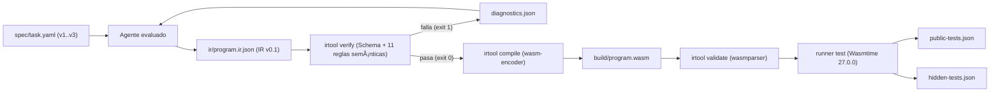

---
type: poc-report
version: 1
conclusion: validated
source_fingerprint: 4a578887e54fc9997ada480e97335dc08c27b6672c306fdee049b32b32939866
created_at: '2026-10-16'
---

# Kaddo Agent-Native POC 001 — Final Report (`v001`)

> Reporte canónico sincronizado con [knowledge/delivery/poc-report-v001.md](knowledge/delivery/poc-report-v001.md).

## Executive Summary

| Atributo | Valor observado / verificado |
|---|---|
| **Experimento** | `KADDO-AGENT-NATIVE-POC-001` — Semantic IR v0.1 compilada directamente a WebAssembly |
| **Conclusión canónica** | **`validated`** |
| **Decisión recomendada** | **`GO`** |
| **Success Criteria cumplidos** | `16 / 16` (`SC-01` a `SC-16`) |
| **Ejercicios completados** | `E1` (Construcción y freeze), `E2` (Reparación controlada), `E3` (Extensión funcional), `E4` (Mantenimiento localizado) |
| **Ediciones manuales humanas a la IR** | `0` (medido) |
| **Cambios al backend tras el freeze (`E1`)** | `0` (`backend_modified_since_freeze = false`, medido) |
| **Reproducibilidad binaria (`E4`)** | `3 / 3` compilaciones consecutivas idénticas (`sha256 = 947620fe23636397ba820b7cadf673e95fb3e09f68591bd0b54bfc8183d0a450`, medido) |

`KADDO-AGENT-NATIVE-POC-001` validó empíricamente que un agente puede construir (`E1`), reparar a partir de diagnósticos deterministas (`E2`), extender con nuevas funciones (`E3`) y mantener reglas comerciales existentes (`E4`) operando exclusivamente sobre una representación intermedia semántica (`ir/program.ir.json`, Semantic IR v0.1), mientras un micro-toolchain determinista en Rust (`irtool` + `runner` sobre Wasmtime) verifica la semántica y emite directamente módulos binarios WebAssembly (`.wasm`) sin pasar por código fuente tradicional de negocio ni requerir modificaciones posteriores al congelamiento (`poc-e1-freeze`).

## Problem and Objective

En el desarrollo asistido por IA actual, los agentes operan sobre lenguajes fuente diseñados para humanos (Rust, TypeScript, Python, Go), donde una fracción significativa del esfuerzo de inferencia y revisión se consume en sintaxis accidental, boilerplate y diagnósticos orientados a edición manual.

El objetivo de `KADDO-AGENT-NATIVE-POC-001` fue comprobar, dentro de un dominio acotado de reglas comerciales puras sin I/O, si una **Semantic IR v0.1** explícita, pequeña y fuertemente tipada puede actuar como **artefacto primario de software mantenido por el agente**, delegando la verificación estructural/semántica, la compilación directa a `.wasm` y la ejecución de pruebas a una frontera 100 % determinista.

## Hypothesis and Success Criteria

- **Hipótesis principal (`H1`):** Para funciones puras de reglas de negocio sin I/O, un agente puede operar sobre una Semantic IR v0.1 como artefacto principal de software y, apoyado en un verificador determinista, un compilador directo `IR → WASM` y un runner de pruebas en Wasmtime, completar construcción (`E1`), reparación controlada (`E2`), extensión (`E3`) y mantenimiento (`E4`) sin editar código fuente tradicional ni modificar el compilador después del punto de congelamiento.

| ID | Criterio | Estado | Evidencia medida |
|---|---|---|---|
| `SC-01` | E1 corrección (`100 %` públicas y reservadas) | Cumplido (`[x]`) | `6/6` públicas y `9/9` reservadas en `runs/e1-build/attempt-01/` |
| `SC-02` | E1 autonomía (`0` ediciones manuales humanas a IR) | Cumplido (`[x]`) | `manual_ir_edits = 0` en `runs/e1-build/attempt-01/run.json` |
| `SC-03` | Límite de reparación inicial en E1 (`<= 2` intentos) | Cumplido (`[x]`) | `repair_attempts = 0` (aprobado en el primer intento) |
| `SC-04` | E2 rechazo determinista (`exit != 0`, código y ruta) | Cumplido (`[x]`) | `exit code = 1`, `E_UNKNOWN_PARAM` en `$.functions[0].body.condition.left` (`diagnostics.injected.json`) |
| `SC-05` | E2 reparación (`<= 2` intentos, `100 %` pruebas E1) | Cumplido (`[x]`) | Reparado en `1` intento; `6/6` públicas + `9/9` reservadas (`runs/e2-repair/attempt-01/`) |
| `SC-06` | E3 extensión (`calculate_discount` + regresión) | Cumplido (`[x]`) | `12/12` públicas + `18/18` reservadas (`runs/e3-extend/attempt-01/`) |
| `SC-07` | E3 estabilidad de toolchain post-freeze | Cumplido (`[x]`) | Hashes de `irtool.exe` y `runner.exe` idénticos a `runs/toolchain-freeze.sha256` |
| `SC-08` | E4 mantenimiento (`calculate_shipping` v3 + regresión) | Cumplido (`[x]`) | `12/12` públicas + `18/18` reservadas (`runs/e4-maintain/attempt-01/`) |
| `SC-09` | E4 estabilidad de toolchain post-freeze | Cumplido (`[x]`) | Hashes de `irtool.exe` y `runner.exe` idénticos a `runs/toolchain-freeze.sha256` |
| `SC-10` | Validez WASM (`wasmparser` / `irtool validate`) | Cumplido (`[x]`) | `wasm_valid = true` en `E1`, `E2`, `E3` y `E4` |
| `SC-11` | Reproducibilidad (`3/3` compilaciones idénticas en E4) | Cumplido (`[x]`) | `3/3` builds con `sha256 = 947620fe23636397ba820b7cadf673e95fb3e09f68591bd0b54bfc8183d0a450` |
| `SC-12` | Fuente de verdad (sin ediciones manuales a WAT/WASM) | Cumplido (`[x]`) | Todo `.wasm` y `.wat` fue emitido por `irtool compile` desde `ir/program.ir.json` |
| `SC-13` | Aislamiento de negocio (sin implementación paralela) | Cumplido (`[x]`) | `crates/irtool` y `crates/runner` son genéricos para IR v0.1 |
| `SC-14` | Evidencia completa en `runs/<exercise>/<attempt>/` | Cumplido (`[x]`) | Todos los artefactos requeridos existen para `E1`–`E4` |
| `SC-15` | Trazabilidad función/caso → requirement ID | Cumplido (`[x]`) | `SHIP-001..003` y `DISC-001..003` trazados en IR y reportes de `runner` |
| `SC-16` | Cero bypass de pruebas, verifier o especificación | Cumplido (`[x]`) | Ningún criterio ni caso esperado fue relajado |

## Scope, Constraints and Non-goals

- **Alcance técnico incluido (`IR v0.1`):** Tipos escalares `i32` y `bool`, funciones exportadas puras, literales (`const`), referencias a parámetros (`param`), condicional ternario (`if`), comparaciones (`eq`, `lt_s`, `gte_s`), aritmética entera con signo (`add`, `sub`, `mul`, `div_s`), operadores booleanos (`and`, `or`, `not`), trazabilidad por `requirements` y compilación directa a WebAssembly Core Module.
- **Restricciones activas:** Cero ediciones manuales a `ir/program.ir.json`, `.wat` o `.wasm`; congelamiento estricto del backend (`irtool` y `runner`) tras `E1` (`poc-e1-freeze`); ejecución determinista sin I/O ni capacidades de host.
- **Non-goals respetados:** No se diseñó un lenguaje generalista completo, no se incluyó memoria lineal dinámica ni strings/colecciones, no se integraron servicios externos (HTTP, bases de datos, colas) ni WASI, y no se ejecutó aún el benchmark comparativo pareado frente a Rust (`KAN-POC-WI-008`, diferido por diseño a la segunda fase).

## Technical Approach and Architecture

La arquitectura separa estrictamente la **zona probabilística** (donde el agente traduce cambios de especificación o diagnósticos en mutaciones sobre el AST JSON de `ir/program.ir.json`) de la **zona determinista** (implementada en Rust mediante dos crates genéricos: `crates/irtool` con `wasm-encoder`, `wasmparser` y `wasmprinter`, y `crates/runner` con `wasmtime`).

## Infrastructure and Project Resources

| Recurso / Componente | Tipo | Versión / Hash observado | Rol en la POC |
|---|---|---|---|
| `rustc` / `cargo` | Compilador host | `1.85.0 (4d91de4e4 2025-02-17)` | Compilación de la toolchain determinista (`irtool`, `runner`) |
| `wasmtime` | Runtime WASM embebido | `27.0.0` | Ejecución aislada de funciones exportadas en `crates/runner` |
| `wasm-encoder` / `wasmparser` / `wasmprinter` | Bytecode Alliance crates | `0.221.3` | Emisión binaria `.wasm`, validación independiente e inspección `.wat` |
| `target/debug/irtool.exe` | Binario congelado (`E1`) | `sha256: 05b0d4c4d8bd85b5fcd7cbcfafa92dccb9b57d0a240464d50a5c874452604d0e` | Verifier + Compiler directo `IR → WASM` |
| `target/debug/runner.exe` | Binario congelado (`E1`) | `sha256: 808cf7f6a6b88aedb141a2d09d75d999d3f36b8824aa1837b19113fb9963782c` | Ejecutor determinista de suites YAML públicas y reservadas |

## Implementation and Relevant Technical Decisions

| Work Item | Decisión técnica relevante | Justificación |
|---|---|---|
| `WI-001` | Formalización de `ir/ir.schema.json` (Draft 2020-12) y tabla de tipado con `eq` polimórfico `(i32, i32)` / `(bool, bool)` | Evitar ambigüedades entre la especificación de `E3` (`premium == false`) y el verificador semántico |
| `WI-002` | Emisión directa a `.wasm` mediante `wasm-encoder` e integración de `wasmparser` (`irtool validate`) y `wasmprinter` (`irtool print`) | Cumplir la ruta principal sin pasar por código fuente ni depender de binarios externos fuera del `PATH` |
| `WI-003` | Sellado del freeze point en el tag `poc-e1-freeze` y registro en `runs/toolchain-freeze.sha256` | Garantizar auditabilidad criptográfica de que `E2`, `E3` y `E4` no alteran el backend |
| `WI-004`–`WI-006` | Evolución exclusiva sobre `ir/program.ir.json` con snapshots antes/después y `diff.patch` por intento | Demostrar localidad del cambio y trazabilidad por requisito |

## Experiments and Validation

| Ejercicio | Descripción experimental | Resultado medido | Estado |
|---|---|---|---|
| **E1 — Construcción y freeze** (`WI-003`) | Construcción inicial de `calculate_shipping(subtotal_cents: i32) -> i32` desde `spec/task.yaml` v1 y congelamiento del toolchain | `0` diagnósticos en intento 1, `.wasm` de `76 B`, `6/6` públicas y `9/9` reservadas aprobadas | Validado |
| **E2 — Reparación controlada** (`WI-004`) | Inyección del defecto `E_UNKNOWN_PARAM` (`param "subtotal"` en `$.functions[0].body.condition.left`) y reparación guiada por `diagnostics.injected.json` | Rechazo con `exit code = 1`; reparación en `1` intento (`<= 2`), `6/6` públicas, `9/9` reservadas y mismo SHA-256 `.wasm` que `E1` | Validado |
| **E3 — Extensión funcional** (`WI-005`) | Publicación de `spec/task.yaml` v2 añadiendo `calculate_discount(subtotal_cents: i32, premium: bool) -> i32` sin tocar `calculate_shipping` ni el backend | `0` diagnósticos en intento 1, `.wasm` de `134 B`, `12/12` públicas (`6` nuevas + `6` regresión) y `18/18` reservadas aprobadas; hashes del backend intactos | Validado |
| **E4 — Mantenimiento** (`WI-006`) | Publicación de `spec/task.yaml` v3 cambiando `calculate_shipping` (`>= 4000 -> 0`, `< 4000 -> 600`) con `calculate_discount` intacta | Diff localizado de 3 líneas en IR, `0` diagnósticos, `12/12` públicas, `18/18` reservadas, `3/3` builds con idéntico SHA-256; hashes del backend intactos | Validado |

## Results and Measurements

| ID | Métrica | Tipo | E1 (`WI-003`) | E2 (`WI-004`) | E3 (`WI-005`) | E4 (`WI-006`) | Gate |
|---|---|---|---|---|---|---|---|
| `M01` | Public test pass rate | Medido | `6/6` (`100 %`) | `6/6` (`100 %`) | `12/12` (`100 %`) | `12/12` (`100 %`) | `100 %` (Cumplido) |
| `M02` | Hidden test pass rate | Medido | `9/9` (`100 %`) | `9/9` (`100 %`) | `18/18` (`100 %`) | `18/18` (`100 %`) | `100 %` (Cumplido) |
| `M03` | IR verifier result (final) | Medido | `true` | `true` (tras rechazar `ir.injected.json`) | `true` | `true` | `true` (Cumplido) |
| `M04` | WASM validation result | Medido | `true` | `true` | `true` | `true` | `true` (Cumplido) |
| `M05` | Repair attempts | Medido | `0` | `1` | `0` | `0` | `<= 2` (Cumplido) |
| `M06` | Manual IR edits | Medido | `0` | `0` | `0` | `0` | `0` (Cumplido) |
| `M07` | Backend changes after freeze | Medido | N/A (freeze) | `0` | `0` | `0` | `0` (Cumplido) |
| `M08` | Reproducible builds (`E4`) | Medido | — | — | — | `3/3` idénticos | `3/3` (Cumplido) |
| `M13` | Verify time (`verify_ms`) | Medido | `12 ms` | `11 ms` | `11 ms` | `11 ms` | Observación |
| `M14` | Compile time (`compile_ms`) | Medido | `15 ms` | `14 ms` | `14 ms` | `14 ms` | Observación |
| `M15` | Test execution time (`test_ms`) | Medido | `16 ms` | `17 ms` | `28 ms` | `28 ms` | Observación |
| `M16` | WASM size (`wasm_size_bytes`) | Medido | `76 B` | `76 B` | `134 B` | `134 B` | Observación |
| `M17` | IR size (líneas / bytes) | Medido | `67 L` / `1336 B` | `67 L` / `1336 B` | `138 L` / `2652 B` | `138 L` / `2652 B` | Observación |
| `M18` | IR change size (`diff.patch`) | Calculado | Construcción inicial | `1` línea modificada | `+71` líneas (`1` función añadida) | `3` líneas modificadas | Observación |
| `M19` | Human clarifications | Medido | `0` | `0` | `0` | `0` | Observación |
| `M20` | Diagnostic count | Medido | `0` | `1` (`E_UNKNOWN_PARAM` inyectado) → `0` | `0` | `0` | Observación |

## Cost and Efficiency Analysis

- **Métricas de tokens y costo monetario del proveedor (`M09`, `M10`, `M11`):** `No evidence available.` (El entorno de ejecución del agente no expone contadores desagregados de tokens ni facturación por llamada individual en `run.json`, registrándose como `null` conforme al esquema permitido en `poc.md`).
- **Eficiencia operativa del ciclo determinista (`M13`–`M16`):** El ciclo completo `verify → compile → validate → test` se ejecutó en menos de `60 ms` totales por intento (medido: `11–12 ms` de verificación, `14–15 ms` de compilación directa a `.wasm` y `16–33 ms` de ejecución en Wasmtime), produciendo binarios extremadamente compactos (`76 bytes` para 1 función y `134 bytes` para 2 funciones) sin sobrecarga de compilación de un toolchain generalista durante la evolución de reglas (`E2`–`E4`).

## Observability and Operational Findings

- **Accionabilidad de diagnósticos estructurados:** El contrato de `diagnostics.json` (con `code`, `function`, `path` en notación JSONPath, `expected` y `found`) permitió localizar y corregir en `1` intento el defecto sembrado en `E2` sin inspección heurística.
- **Auditabilidad por corrida:** La estructura `runs/<exercise>/attempt-01/` con snapshots de entrada/salida, `diff.patch`, desensamblado `.wat` derivado y hashes SHA-256 permitió verificar de forma independiente tanto la corrección funcional como la inmutabilidad del backend congelado en `runs/toolchain-freeze.sha256`.

## Findings, Learnings, Limitations and Risks

| Categoría | Descripción fundamentada en la evidencia |
|---|---|
| **Hallazgo principal** | Una Semantic IR pequeña y fuertemente tipada permite al agente construir, reparar, extender y mantener reglas puras con `0` errores sintácticos y diffs mínimos (`1` a `3` líneas en reparación y mantenimiento). |
| **Aprendizaje de ingeniería** | La inversión de complejidad ocurre una sola vez al construir el verifier y el lowering `IR → WASM` (`WI-002`); una vez congelado el toolchain (`E1`), la evolución funcional (`E3`, `E4`) es inmediata y determinista. |
| **Limitación actual** | `IR v0.1` está deliberadamente restringida a funciones escalares puras (`i32`, `bool`) sin estructuras compuestas, llamadas entre funciones, memoria lineal ni I/O. |
| **Riesgo para fases siguientes** | Al escalar a tipos compuestos, múltiples módulos o capacidades externas (`POC 002`), un diseño excesivamente expresivo de la IR podría reintroducir la complejidad accidental de un lenguaje fuente tradicional si no se mantiene acotado por dominio. |

## Conclusion

- **Status:** **`validated`**
- **Decision:** **`GO`**

Los `16/16` Success Criteria (`SC-01`–`SC-16`) fueron satisfechos sin excepciones ni desviaciones respecto al protocolo experimental de `knowledge/delivery/poc.md`. Queda validada la hipótesis `H1` para el alcance de funciones puras de reglas comerciales compiladas directamente desde Semantic IR v0.1 a WebAssembly.

## Recommendation and Next Steps

1. **Benchmark comparativo pareado `Agent-Native IR → WASM` vs `Rust → wasm32-unknown-unknown` (`KAN-POC-WI-008`):** Ejecutar la misma secuencia `E1`–`E4` con las mismas especificaciones y suites públicas/reservadas pidiendo al agente implementar en Rust, comparando intentos de reparación, tiempo de compilación, tamaño binario y localidad del diff.
2. **Diseño de `KADDO-AGENT-NATIVE-POC-002` (Complejidad incremental sin I/O):** Extender el contrato de la Semantic IR a `v0.2` para evaluar llamadas entre funciones internas, tipos compuestos (records/structs de entrada) y errores de dominio explícitamente tipados en lugar de la convención `-1`.
3. **Exploración posterior de Capability ABI:** Sólo tras validar composición y tipos estructurados en `POC 002`, investigar un ABI de capacidades declarativas para efectos externos controlados.

## Traceability and Sources

| Fuente / Artefacto | Tipo | Ruta relativa en el repositorio |
|---|---|---|
| Definición y conclusión canónica de la POC | POC Artifact | [knowledge/delivery/poc.md](knowledge/delivery/poc.md) |
| Contrato experimental e IR v0.1 | Work Item (`completed`) | [knowledge/delivery/work-items/completed/WI-001-contrato-experimental-e-ir-v0-1.md](knowledge/delivery/work-items/completed/WI-001-contrato-experimental-e-ir-v0-1.md) |
| Verifier + compiler directo a WASM + runner | Work Item (`completed`) | [knowledge/delivery/work-items/completed/WI-002-verifier-compiler-directo-a-wasm-y-runner.md](knowledge/delivery/work-items/completed/WI-002-verifier-compiler-directo-a-wasm-y-runner.md) |
| E1 construcción y freeze | Work Item (`completed`) | [knowledge/delivery/work-items/completed/WI-003-e1-construccion-y-freeze.md](knowledge/delivery/work-items/completed/WI-003-e1-construccion-y-freeze.md) |
| E2 reparación controlada | Work Item (`completed`) | [knowledge/delivery/work-items/completed/WI-004-e2-reparacion-controlada.md](knowledge/delivery/work-items/completed/WI-004-e2-reparacion-controlada.md) |
| E3 extensión funcional | Work Item (`completed`) | [knowledge/delivery/work-items/completed/WI-005-e3-extension-funcional.md](knowledge/delivery/work-items/completed/WI-005-e3-extension-funcional.md) |
| E4 mantenimiento | Work Item (`completed`) | [knowledge/delivery/work-items/completed/WI-006-e4-mantenimiento.md](knowledge/delivery/work-items/completed/WI-006-e4-mantenimiento.md) |
| Análisis y conclusión | Work Item (`completed`) | [knowledge/delivery/work-items/completed/WI-007-analisis-y-conclusion.md](knowledge/delivery/work-items/completed/WI-007-analisis-y-conclusion.md) |
| Evidencia reproducible E1 | Run Evidence | [runs/e1-build/attempt-01/run.json](runs/e1-build/attempt-01/run.json) |
| Evidencia reproducible E2 | Run Evidence | [runs/e2-repair/attempt-01/run.json](runs/e2-repair/attempt-01/run.json) |
| Evidencia reproducible E3 | Run Evidence | [runs/e3-extend/attempt-01/run.json](runs/e3-extend/attempt-01/run.json) |
| Evidencia reproducible E4 | Run Evidence | [runs/e4-maintain/attempt-01/run.json](runs/e4-maintain/attempt-01/run.json) |
| Freeze de toolchain | SHA-256 Manifest | [runs/toolchain-freeze.sha256](runs/toolchain-freeze.sha256) |
