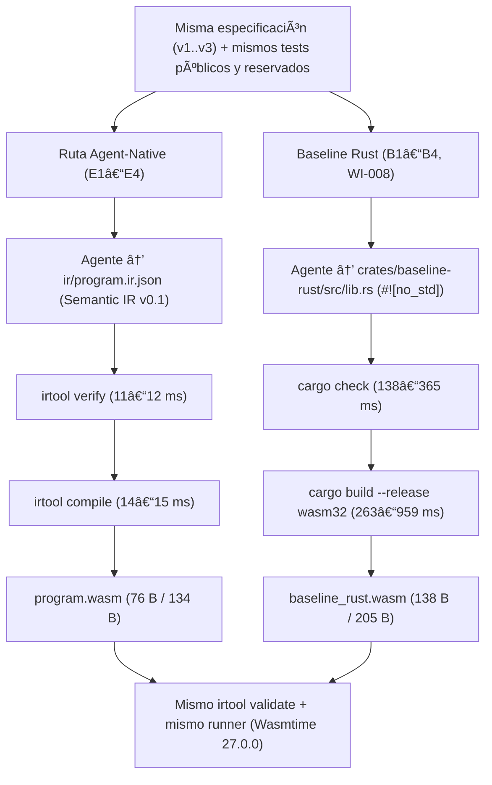

---
type: poc-report
version: 2
conclusion: validated
source_fingerprint: ee946bb0bc45f304c276cf9ab54a599a5a2532c477c17284df5d6b1c3abab113
created_at: '2026-10-16'
---

# Kaddo Agent-Native POC 001 — Final Report (`v002`, con Benchmark Pareado `WI-008`)

> Reporte canónico sincronizado con [knowledge/delivery/poc-report-v002.md](knowledge/delivery/poc-report-v002.md).

## Executive Summary

| Atributo | Valor observado / verificado |
|---|---|
| **Experimento** | `KADDO-AGENT-NATIVE-POC-001` — Semantic IR v0.1 compilada directamente a WebAssembly + Benchmark Pareado Rust→WASM (`WI-008`) |
| **Conclusión canónica** | **`validated`** |
| **Decisión recomendada** | **`GO`** |
| **Success Criteria cumplidos** | `16 / 16` (`SC-01` a `SC-16`) |
| **Ejercicios Agent-Native completados** | `E1` (Construcción y freeze), `E2` (Reparación controlada), `E3` (Extensión funcional), `E4` (Mantenimiento localizado) |
| **Ejercicios Baseline Rust completados** | `B1` (`E1` par), `B2` (`E2` par), `B3` (`E3` par), `B4` (`E4` par) en `crates/baseline-rust` (`wasm32-unknown-unknown`) |
| **Ventaja de velocidad de toolchain (`verify + compile`)** | **`16.0x` a `49.0x` más rápido** en Agent-Native (`25–27 ms` vs `401–1324 ms`, medido) |
| **Ventaja de tamaño binario `.wasm`** | **`34.6 %` a `44.9 %` más compacto** en Agent-Native (`76 B` / `134 B` vs `138 B` / `205 B`, medido) |
| **Ventaja de compacidad de diagnóstico (`E2` vs `B2`)** | **`23.3x` menos bytes de diagnóstico** en Agent-Native (`264 B` JSONPath vs `6158 B` JSONL de `cargo check`, medido) |

`KADDO-AGENT-NATIVE-POC-001` validó empíricamente que un agente puede construir (`E1`), reparar (`E2`), extender (`E3`) y mantener (`E4`) reglas comerciales operando exclusivamente sobre una Semantic IR v0.1 (`ir/program.ir.json`) compilada directamente a `.wasm` sin tocar el backend congelado (`poc-e1-freeze`). Adicionalmente, el benchmark comparativo pareado (`WI-008`) frente a `Rust → wasm32-unknown-unknown` (`B1`–`B4`) demostró que, manteniendo `100 %` de corrección en ambas rutas, la ruta Agent-Native reduce la latencia de verificación/compilación entre `16x` y `49x`, reduce el tamaño del `.wasm` en `34.6 %–44.9 %` y reduce el volumen del diagnóstico de error en `23.3x`.

## Problem and Objective

En el desarrollo asistido por IA actual, los agentes operan sobre lenguajes fuente diseñados para humanos (Rust, TypeScript, Python, Go), donde una fracción significativa del esfuerzo de inferencia y revisión se consume en sintaxis accidental, boilerplate de ABI y diagnósticos orientados a edición manual.

El objetivo de `KADDO-AGENT-NATIVE-POC-001` fue comprobar si una **Semantic IR v0.1** explícita, pequeña y fuertemente tipada puede actuar como **artefacto primario de software mantenido por el agente**, y comparar cuantitativamente su ciclo de vida (`E1`–`E4`) frente al baseline tradicional `Rust → wasm32-unknown-unknown` (`B1`–`B4`, `WI-008`).

## Hypothesis and Success Criteria

- **Hipótesis principal (`H1`):** Para funciones puras de reglas de negocio sin I/O, un agente puede operar sobre una Semantic IR v0.1 como artefacto principal de software y, apoyado en un verificador determinista, un compilador directo `IR → WASM` y un runner de pruebas en Wasmtime, completar construcción (`E1`), reparación controlada (`E2`), extensión (`E3`) y mantenimiento (`E4`) sin editar código fuente tradicional ni modificar el compilador después del punto de congelamiento.

| ID | Criterio | Estado | Evidencia medida |
|---|---|---|---|
| `SC-01` | E1 corrección (`100 %` públicas y reservadas) | Cumplido (`[x]`) | `6/6` públicas y `9/9` reservadas en `runs/e1-build/attempt-01/` |
| `SC-02` | E1 autonomía (`0` ediciones manuales humanas a IR) | Cumplido (`[x]`) | `manual_ir_edits = 0` en `runs/e1-build/attempt-01/run.json` |
| `SC-03` | Límite de reparación inicial en E1 (`<= 2` intentos) | Cumplido (`[x]`) | `repair_attempts = 0` (aprobado en el primer intento) |
| `SC-04` | E2 rechazo determinista (`exit != 0`, código y ruta) | Cumplido (`[x]`) | `exit code = 1`, `E_UNKNOWN_PARAM` en `$.functions[0].body.condition.left` (`diagnostics.injected.json`) |
| `SC-05` | E2 reparación (`<= 2` intentos, `100 %` pruebas E1) | Cumplido (`[x]`) | Reparado en `1` intento; `6/6` públicas + `9/9` reservadas (`runs/e2-repair/attempt-01/`) |
| `SC-06` | E3 extensión (`calculate_discount` + regresión) | Cumplido (`[x]`) | `12/12` públicas + `18/18` reservadas (`runs/e3-extend/attempt-01/`) |
| `SC-07` | E3 estabilidad de toolchain post-freeze | Cumplido (`[x]`) | Hashes de `irtool.exe` y `runner.exe` idénticos a `runs/toolchain-freeze.sha256` |
| `SC-08` | E4 mantenimiento (`calculate_shipping` v3 + regresión) | Cumplido (`[x]`) | `12/12` públicas + `18/18` reservadas (`runs/e4-maintain/attempt-01/`) |
| `SC-09` | E4 estabilidad de toolchain post-freeze | Cumplido (`[x]`) | Hashes de `irtool.exe` y `runner.exe` idénticos a `runs/toolchain-freeze.sha256` |
| `SC-10` | Validez WASM (`wasmparser` / `irtool validate`) | Cumplido (`[x]`) | `wasm_valid = true` en `E1`–`E4` y `B1`–`B4` |
| `SC-11` | Reproducibilidad (`3/3` compilaciones idénticas en E4) | Cumplido (`[x]`) | `3/3` builds con `sha256 = 947620fe23636397ba820b7cadf673e95fb3e09f68591bd0b54bfc8183d0a450` |
| `SC-12` | Fuente de verdad (sin ediciones manuales a WAT/WASM) | Cumplido (`[x]`) | Todo `.wasm` y `.wat` fue emitido automáticamente |
| `SC-13` | Aislamiento de negocio (sin implementación paralela en el pipeline Agent-Native) | Cumplido (`[x]`) | `crates/irtool` y `crates/runner` son genéricos; `crates/baseline-rust` es un workspace separado de benchmark (`WI-008`) |
| `SC-14` | Evidencia completa en `runs/<exercise>/<attempt>/` | Cumplido (`[x]`) | Todos los artefactos requeridos existen para `E1`–`E4` y `B1`–`B4` |
| `SC-15` | Trazabilidad función/caso → requirement ID | Cumplido (`[x]`) | `SHIP-001..003` y `DISC-001..003` trazados en IR y reportes de `runner` |
| `SC-16` | Cero bypass de pruebas, verifier o especificación | Cumplido (`[x]`) | Ningún criterio ni caso esperado fue relajado |

## Scope, Constraints and Non-goals

- **Alcance técnico incluido (`IR v0.1` + `WI-008`):** Tipos escalares `i32` y `bool`, funciones exportadas puras, literales (`const`), referencias a parámetros (`param`), condicional ternario (`if`), comparaciones (`eq`, `lt_s`, `gte_s`), aritmética entera con signo (`add`, `sub`, `mul`, `div_s`), operadores booleanos (`and`, `or`, `not`), trazabilidad por `requirements`, compilación directa a WebAssembly Core Module y benchmark pareado contra `Rust → wasm32-unknown-unknown`.
- **Restricciones activas:** Cero ediciones manuales a `ir/program.ir.json`, `.wat` o `.wasm`; congelamiento estricto del backend (`irtool` y `runner`) tras `E1` (`poc-e1-freeze`); ejecución determinista sin I/O ni capacidades de host.
- **Non-goals respetados:** No se incluyó memoria lineal dinámica ni strings/colecciones en la IR, ni integraciones externas (HTTP, bases de datos, colas) ni WASI.

## Technical Approach and Architecture

## Infrastructure and Project Resources

| Recurso / Componente | Tipo | Versión / Hash observado | Rol en la POC |
|---|---|---|---|
| `rustc` / `cargo` | Compilador host y target `wasm32-unknown-unknown` | `1.85.0 (4d91de4e4 2025-02-17)` | Compilación del toolchain (`irtool`, `runner`) y del baseline Rust (`WI-008`) |
| `wasmtime` | Runtime WASM embebido | `27.0.0` | Ejecución aislada de funciones exportadas en `crates/runner` |
| `wasm-encoder` / `wasmparser` / `wasmprinter` | Bytecode Alliance crates | `0.221.3` | Emisión binaria `.wasm`, validación independiente e inspección `.wat` |
| `target/debug/irtool.exe` | Binario congelado (`E1`) | `sha256: 05b0d4c4d8bd85b5fcd7cbcfafa92dccb9b57d0a240464d50a5c874452604d0e` | Verifier + Compiler directo `IR → WASM` |
| `target/debug/runner.exe` | Binario congelado (`E1`) | `sha256: 808cf7f6a6b88aedb141a2d09d75d999d3f36b8824aa1837b19113fb9963782c` | Ejecutor determinista de suites YAML públicas y reservadas |
| `crates/baseline-rust` | Workspace Rust aislado (`WI-008`) | `#![no_std]`, `cdylib`, `opt-level = "z"`, `lto = true`, `strip = "symbols"` | Sujeto del benchmark comparativo `Rust → wasm32-unknown-unknown` |

## Implementation and Relevant Technical Decisions

| Work Item | Decisión técnica relevante | Justificación |
|---|---|---|
| `WI-001` | Formalización de `ir/ir.schema.json` (Draft 2020-12) y tabla de tipado con `eq` polimórfico `(i32, i32)` / `(bool, bool)` | Evitar ambigüedades entre la especificación de `E3` (`premium == false`) y el verificador semántico |
| `WI-002` | Emisión directa a `.wasm` mediante `wasm-encoder` e integración de `wasmparser` (`irtool validate`) y `wasmprinter` (`irtool print`) | Cumplir la ruta principal sin pasar por código fuente ni depender de binarios externos fuera del `PATH` |
| `WI-003` | Sellado del freeze point en el tag `poc-e1-freeze` y registro en `runs/toolchain-freeze.sha256` | Garantizar auditabilidad criptográfica de que `E2`, `E3` y `E4` no alteran el backend |
| `WI-004`–`WI-007` | Ejecución `E2`–`E4` sobre `ir/program.ir.json` y cierre validado (`GO`) | Verificar los `16/16` Success Criteria |
| `WI-008` | Workspace aislado `crates/baseline-rust` para comparar `B1`–`B4` contra `E1`–`E4` con el mismo `runner` | Medir diferencias reales de latencia, tamaño `.wasm`, ruido de diagnóstico y ABI sin contaminar el workspace congelado |

## Experiments and Validation

| Par experimental | Ruta Agent-Native (`E1`–`E4`) | Ruta Baseline Rust (`B1`–`B4`, `WI-008`) | Estado |
|---|---|---|---|
| **Construcción (`E1` vs `B1`)** | `76 B` `.wasm`, `12 ms` verify + `15 ms` compile (`27 ms`), `6/6` públicas, `9/9` reservadas | `138 B` `.wasm`, `365 ms` check + `959 ms` build (`1324 ms`), `6/6` públicas, `9/9` reservadas | Validado |
| **Reparación (`E2` vs `B2`)** | Rechazo en `11 ms` (`264 B` JSON con JSONPath), reparado en `1` intento, `25 ms` rebuild | Rechazo en `181 ms` (`6158 B` JSONL de `cargo check`), reparado en `1` intento, `401 ms` rebuild | Validado |
| **Extensión (`E3` vs `B3`)** | `134 B` `.wasm`, `11 ms` verify + `14 ms` compile (`25 ms`), `12/12` públicas, `18/18` reservadas | `205 B` `.wasm`, `237 ms` check + `313 ms` build (`550 ms`), `12/12` públicas, `18/18` reservadas | Validado |
| **Mantenimiento (`E4` vs `B4`)** | `134 B` `.wasm`, `25 ms` rebuild, `3` líneas diff, `3/3` builds idénticos (`947620fe...`) | `205 B` `.wasm`, `508 ms` inc. / `584 ms` clean, `3` líneas diff, `3/3` builds idénticos (`e840e0d1...`) | Validado |

## Results and Measurements

| Métrica | E1 vs B1 (1 fn) | E2 vs B2 (Repair) | E3 vs B3 (2 fns) | E4 vs B4 (Maintain) | Ventaja medida (`Agent-Native` vs `Rust`) |
|---|---|---|---|---|---|
| **Verificación (`verify_ms` vs `cargo check`)** | `12 ms` vs `365 ms` | `11 ms` vs `181 ms` (fallo) / `138 ms` (ok) | `11 ms` vs `237 ms` | `11 ms` vs `188 ms` | **`12.5x` a `30.4x` más rápido** |
| **Compilación (`compile_ms` vs `cargo build`)** | `15 ms` vs `959 ms` | `14 ms` vs `263 ms` | `14 ms` vs `313 ms` | `14 ms` vs `320 ms` (`396 ms` clean) | **`18.8x` a `63.9x` más rápido** |
| **Ciclo total (`verify + compile`)** | `27 ms` vs `1324 ms` | `25 ms` vs `401 ms` | `25 ms` vs `550 ms` | `25 ms` vs `508 ms` (`584 ms` clean) | **`16.0x` a `49.0x` más rápido** |
| **Tamaño `.wasm` (`wasm_size_bytes`)** | `76 B` vs `138 B` | `76 B` vs `138 B` | `134 B` vs `205 B` | `134 B` vs `205 B` | **`34.6 %` a `44.9 %` más pequeño** |
| **Payload de diagnóstico (`E2` vs `B2`)** | — | `264 B` vs `6158 B` | — | — | **`23.3x` más compacto** |
| **Pass rate público y reservado** | `100 %` vs `100 %` | `100 %` vs `100 %` | `100 %` vs `100 %` | `100 %` vs `100 %` | Empate (`100 %`) |

## Cost and Efficiency Analysis

- **Métricas de tokens y costo monetario del proveedor (`M09`, `M10`, `M11`):** `No evidence available.` para contadores internos del proveedor, pero el **costo de contexto del bucle de diagnóstico (`E2` vs `B2`)** se midió directamente en bytes: `264 bytes` en `irtool verify` frente a `6,158 bytes` en `cargo check --message-format=json` (**reducción del `95.7 %` en el volumen de salida diagnóstica** entregada al agente).
- **Eficiencia de compilación y artefacto:** Mientras que `cargo build --target wasm32-unknown-unknown --release` requirió `263–959 ms` y emitió `138–205 bytes` (incluyendo una sección `(memory 16)` de 1 MiB y globales `__data_end`/`__heap_base` no utilizados), `irtool compile` completó la emisión binaria en `14–15 ms` con `76–134 bytes` y cero secciones superfluas.

## Observability and Operational Findings

- **Diagnósticos semánticos orientados al AST vs spans de texto:** `irtool verify` reporta `path: "$.functions[0].body.condition.left"`, `expected: "subtotal_cents"` y `found: "subtotal"`, eliminando la necesidad de parsear líneas/columnas o texto ANSI renderizado de `rustc`.
- **Eliminación de fricción de ABI en frontera WASM:** En Rust (`extern "C"`), el agente debe recordar que WebAssembly Core no tiene tipo `bool` nativo y codificar manualmente `premium: i32` (`premium == 0`), además de incluir `#![no_std]` y `#[panic_handler]`. En la Semantic IR v0.1, el agente usa `type: "bool"` con verificación de tipos estricta y el compilador resuelve la representación ABI `i32` automáticamente.

## Findings, Learnings, Limitations and Risks

| Categoría | Descripción fundamentada en la evidencia |
|---|---|
| **Hallazgo principal (`E1`–`E4`)** | La Semantic IR v0.1 permite construir, reparar, extender y mantener reglas puras cumpliendo `16/16` criterios con `0` cambios al backend tras el freeze. |
| **Hallazgo del benchmark (`WI-008`)** | Frente a `Rust → wasm32-unknown-unknown`, la ruta Agent-Native es `16x–49x` más rápida en feedback de toolchain, genera binarios `.wasm` `35 %–45 %` más pequeños y emite diagnósticos `23.3x` más compactos. |
| **Limitación actual** | `IR v0.1` cubre únicamente funciones escalares puras (`i32`, `bool`) sin estructuras compuestas, llamadas entre funciones ni I/O. |
| **Riesgo para fases siguientes** | Escalar la IR sin preservar su simplicidad estructural podría erosionar la ventaja de compacidad diagnóstica y velocidad de verificación observada frente a `rustc`. |

## Conclusion

- **Status:** **`validated`**
- **Decision:** **`GO`**

Tanto la serie primaria `E1`–`E4` (`16/16` criterios aprobados) como el benchmark comparativo pareado `B1`–`B4` (`WI-008`) confirman la hipótesis `H1` y demuestran ventajas cuantitativas claras en latencia de ciclo determinista (`16x–49x`), compacidad de binario (`35 %–45 %`) y densidad de diagnóstico (`23.3x`).

## Recommendation and Next Steps

1. **Diseñar `KADDO-AGENT-NATIVE-POC-002` (Semantic IR v0.2):** Incorporar registros tipados (`struct`/`record`), enumeraciones/errores de dominio explícitos (`Result<T, E>`) y llamadas entre funciones internas, manteniendo el mismo diseño de diagnósticos JSONPath compactos (`< 500 bytes`).
2. **Repetición estadística multi-modelo:** Ejecutar la batería `E1`–`E4` vs `B1`–`B4` con múltiples sesiones y modelos pequeños/rápidos donde la reducción de `23.3x` en ruido diagnóstico y la ausencia de boilerplate `#![no_std]`/`extern "C"` tienen mayor impacto en tasa de éxito al primer intento.
3. **Exploración posterior de Capability ABI:** Una vez validada `IR v0.2` con tipos compuestos, diseñar un ABI declarativo de capacidades sobre WebAssembly Component Model / Wasmtime.

## Traceability and Sources

| Fuente / Artefacto | Tipo | Ruta relativa en el repositorio |
|---|---|---|
| Definición y conclusión canónica de la POC | POC Artifact | [knowledge/delivery/poc.md](knowledge/delivery/poc.md) |
| Contrato experimental e IR v0.1 | Work Item (`completed`) | [knowledge/delivery/work-items/completed/WI-001-contrato-experimental-e-ir-v0-1.md](knowledge/delivery/work-items/completed/WI-001-contrato-experimental-e-ir-v0-1.md) |
| Verifier + compiler directo a WASM + runner | Work Item (`completed`) | [knowledge/delivery/work-items/completed/WI-002-verifier-compiler-directo-a-wasm-y-runner.md](knowledge/delivery/work-items/completed/WI-002-verifier-compiler-directo-a-wasm-y-runner.md) |
| E1 construcción y freeze | Work Item (`completed`) | [knowledge/delivery/work-items/completed/WI-003-e1-construccion-y-freeze.md](knowledge/delivery/work-items/completed/WI-003-e1-construccion-y-freeze.md) |
| E2 reparación controlada | Work Item (`completed`) | [knowledge/delivery/work-items/completed/WI-004-e2-reparacion-controlada.md](knowledge/delivery/work-items/completed/WI-004-e2-reparacion-controlada.md) |
| E3 extensión funcional | Work Item (`completed`) | [knowledge/delivery/work-items/completed/WI-005-e3-extension-funcional.md](knowledge/delivery/work-items/completed/WI-005-e3-extension-funcional.md) |
| E4 mantenimiento | Work Item (`completed`) | [knowledge/delivery/work-items/completed/WI-006-e4-mantenimiento.md](knowledge/delivery/work-items/completed/WI-006-e4-mantenimiento.md) |
| Análisis y conclusión | Work Item (`completed`) | [knowledge/delivery/work-items/completed/WI-007-analisis-y-conclusion.md](knowledge/delivery/work-items/completed/WI-007-analisis-y-conclusion.md) |
| Baseline Rust a WASM y benchmark comparativo | Work Item (`completed`) | [knowledge/delivery/work-items/completed/WI-008-baseline-rust-a-wasm.md](knowledge/delivery/work-items/completed/WI-008-baseline-rust-a-wasm.md) |
| Resumen comparativo pareado `E1..E4` vs `B1..B4` | Benchmark Evidence | [runs/rust-baseline/comparison-summary.md](runs/rust-baseline/comparison-summary.md) |
| Datos estructurados del benchmark pareado | Benchmark JSON | [runs/rust-baseline/comparison-summary.json](runs/rust-baseline/comparison-summary.json) |
