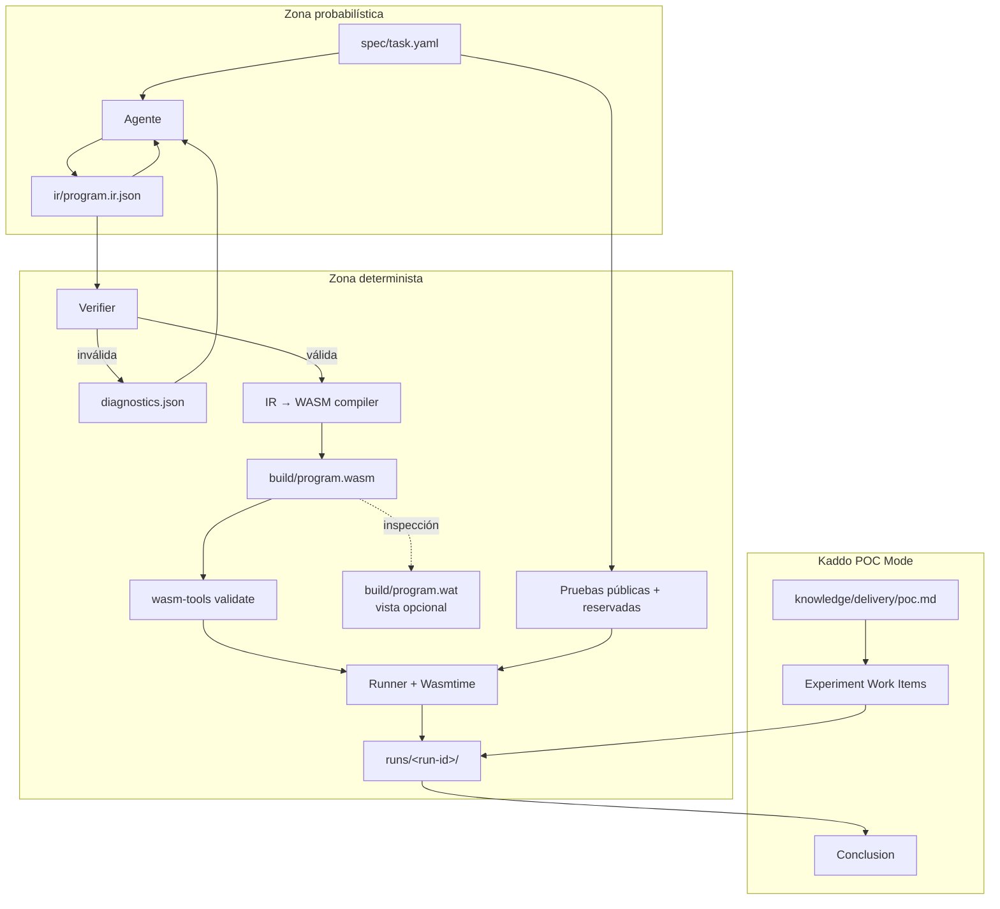
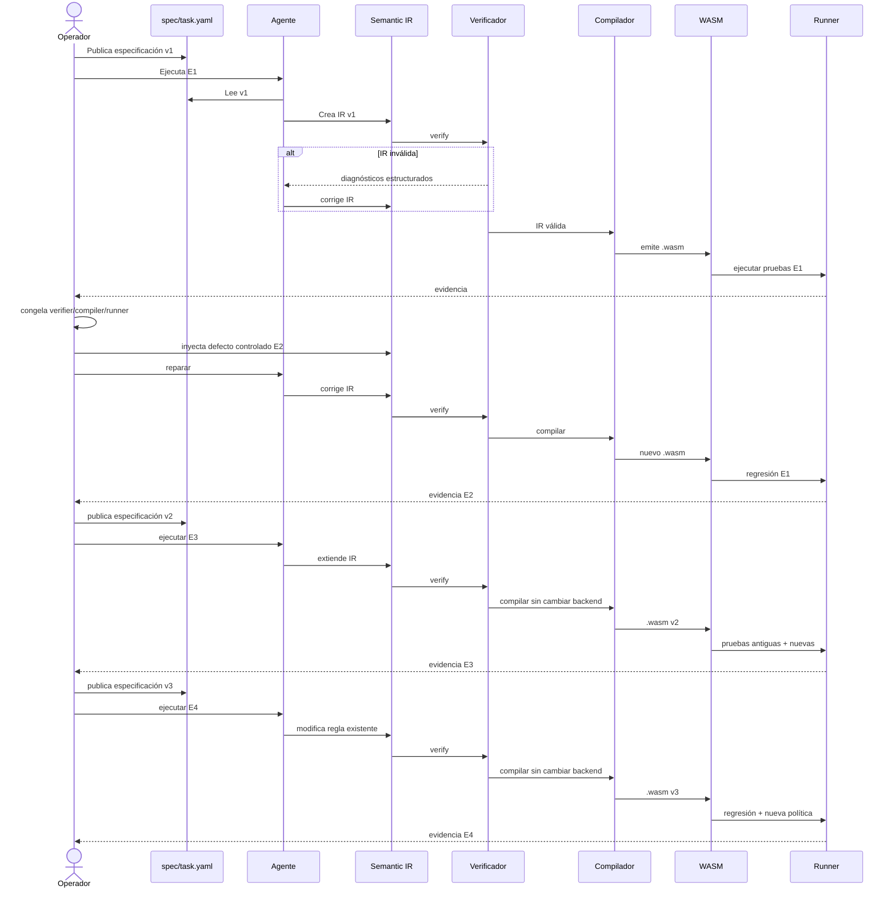
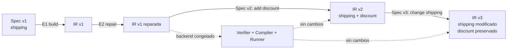
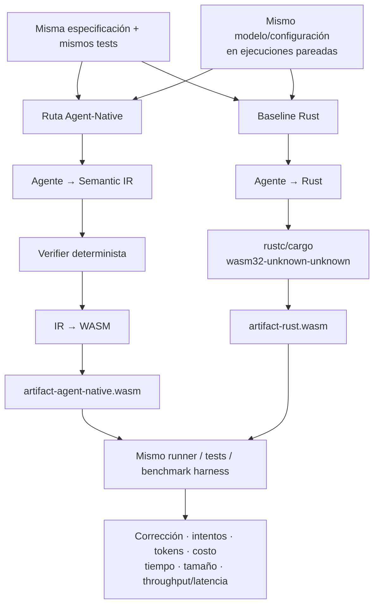

# Kaddo Agent-Native POC 001 — Semantic IR como artefacto principal de software

> **Artefacto canónico:** `knowledge/delivery/poc.md`
>
> **Pregunta de investigación:** ¿puede un agente construir, corregir, mantener y extender un programa usando una Semantic IR como artefacto principal, mientras herramientas deterministas verifican esa IR y la convierten directamente en WebAssembly ejecutable?
>
> **Naturaleza:** POC de investigación técnica, falsable y reproducible.
>
> **Modalidad:** Kaddo POC Mode.
>
> **Regla de interpretación:** un resultado exitoso valida solamente este flujo acotado; no demuestra todavía que una Semantic IR sustituya lenguajes de propósito general ni que produzca software más rápido, barato o seguro que Rust/C++.

## Problem

Los agentes de programación actuales suelen implementar software escribiendo código fuente en lenguajes diseñados históricamente para humanos y para toolchains de propósito general. Esta POC investiga una alternativa más estrecha: que el agente opere sobre una representación intermedia semántica, estructurada y verificable, y que una toolchain determinista convierta esa representación a un módulo WebAssembly.

El problema a resolver no es «generar WASM con un LLM». El problema es determinar si una Semantic IR puede convertirse en el **estado mantenible del programa** para el agente durante varios ciclos de cambio.

La POC debe separar explícitamente dos zonas:

1. **Zona probabilística:** interpretación de la especificación y creación/modificación de la IR por el agente.
2. **Zona determinista:** validación estructural, verificación semántica, lowering a WebAssembly, validación del binario y ejecución de pruebas.

El experimento debe responder con evidencia a estas preguntas:

- ¿Puede el agente crear una IR válida desde una especificación funcional?
- ¿Puede reparar una IR inválida a partir de diagnósticos estructurados?
- ¿Puede extender un programa conservando comportamiento previo?
- ¿Puede modificar una regla existente sin introducir regresiones?
- ¿Puede el backend permanecer estable después de construir el primer programa?
- ¿Puede producirse el mismo `.wasm` a partir de la misma IR y la misma versión del compilador?
- ¿La representación permite observar qué cambió y por qué sin editar manualmente WAT o WASM?

## Hypothesis

### Hipótesis principal

> **H1.** Dada una especificación funcional explícita y un contrato de Semantic IR limitado, un agente puede crear y evolucionar la IR de un programa a través de ciclos de construcción, reparación, extensión y mantenimiento, mientras una toolchain determinista verifica la IR y genera WebAssembly ejecutable que satisface el 100 % de las pruebas de aceptación y regresión definidas para el experimento.

### Subhipótesis

| ID | Hipótesis | Evidencia que la soporta | Evidencia que la debilita |
|---|---|---|---|
| H1-A | El agente puede construir la IR inicial desde la especificación. | E1 pasa verificación y todas las pruebas. | Requiere edición manual de IR o no logra producir IR válida dentro del límite de intentos. |
| H1-B | Diagnósticos deterministas son suficientes para orientar una reparación. | E2 es reparado por el agente en máximo 2 intentos. | El agente no puede localizar/corregir el defecto o exige modificar el verificador. |
| H1-C | La IR soporta evolución sin recompilar el «lenguaje» cada vez. | E3 y E4 se completan con el compilador/verificador congelados. | Cada cambio funcional exige cambiar el backend o introducir lógica de negocio en él. |
| H1-D | La evolución conserva comportamiento no afectado. | 100 % de pruebas de regresión pasan en E3/E4. | Una modificación rompe comportamiento previamente aceptado. |
| H1-E | El pipeline posterior a la IR puede ser reproducible. | Tres builds consecutivos desde la misma IR producen el mismo SHA-256 del `.wasm`. | El artefacto cambia sin cambio de IR/toolchain/configuración. |

### Hipótesis que **no** se prueba todavía

No se probará que este enfoque sea superior a Rust, C++, Go, Java, TypeScript u otro lenguaje en rendimiento, costo, seguridad o mantenibilidad a escala. Esa comparación pertenece a la investigación posterior.

## Expected Value

Si H1 recibe evidencia favorable, esta POC justificaría investigar un modelo Agent-Native en el que:

- la especificación concentra intención y criterios observables;
- la Semantic IR concentra el estado ejecutable que el agente debe mantener;
- el verificador convierte restricciones en feedback determinista;
- el compilador/lowerer resuelve cómo representar esa semántica en WebAssembly;
- el `.wasm` es un artefacto derivado y nunca el lugar donde se corrige el negocio;
- la trazabilidad se mide por versiones de especificación, IR, diagnósticos, pruebas y hashes de artefactos.

El valor de una respuesta negativa también es alto: permite descubrir tempranamente si la complejidad se desplaza al compilador, si la IR no evoluciona bien, si los diagnósticos no bastan o si el agente trabaja mejor sobre código tradicional.

## Scenario

### Alcance técnico mínimo

La Semantic IR v0.1 soportará únicamente lo necesario para reglas puras sin I/O:

| Área | Incluido |
|---|---|
| Tipos | `i32`, `bool` |
| Funciones | funciones exportadas, parámetros, retorno único |
| Literales | enteros y booleanos |
| Referencias | parámetros por nombre |
| Control | expresión `if` |
| Comparaciones | `eq`, `lt_s`, `gte_s` |
| Aritmética | `add`, `sub`, `mul`, `div_s` |
| Booleanos | `and`, `or`, `not` |
| Trazabilidad | IDs de requisitos por función |
| Target | WebAssembly Core Module |
| Runtime de prueba | Wasmtime mediante runner controlado |

Convenciones de la POC:

- Los valores monetarios usan centavos enteros.
- En la frontera WASM, `bool` se representa como `i32`: `0 = false`, `1 = true`.
- Una entrada monetaria negativa devuelve `-1`. Es una convención de la POC, no un diseño definitivo de errores.
- La división `div_s` es división entera con signo.
- El compilador debe emitir el binario `.wasm` directamente. WAT puede generarse **después** como vista de inspección, pero no es fuente de verdad ni entrada necesaria del pipeline.
- El agente no debe escribir ni editar WAT/WASM.
- Después de E1 se congela la toolchain experimental. E2–E4 prueban evolución del programa, no evolución del compilador.

### Arquitectura del experimento



### Flujo de evolución



### E1 — Construcción inicial

**Objetivo:** comprobar que el agente puede transformar la especificación v1 en una Semantic IR válida y ejecutable.

**Función:**

`calculate_shipping(subtotal_cents: i32) -> i32`

**Reglas:**

- `subtotal_cents < 0` → `-1`
- `subtotal_cents >= 5000` → `0`
- en otro caso → `500`

**Secuencia:**

1. El operador publica `spec/task.yaml` v1.
2. El agente lee la especificación, el contrato de IR y el esquema.
3. El agente crea `ir/program.ir.json`.
4. El verificador ejecuta validación estructural y semántica.
5. Si falla, el agente recibe diagnósticos y puede realizar hasta 2 intentos adicionales.
6. Si pasa, el compilador emite `build/program.wasm`.
7. `wasm-tools validate` valida el módulo.
8. El runner ejecuta pruebas públicas.
9. El operador ejecuta las pruebas reservadas sin exponerlas al agente.
10. Se registra evidencia en `runs/`.
11. Si E1 pasa, se guarda el commit/hash de verifier, compiler y runner como **toolchain freeze point**.

**Casos públicos:**

| Caso | Entrada | Esperado |
|---|---:|---:|
| E1-P01 | `-1` | `-1` |
| E1-P02 | `0` | `500` |
| E1-P03 | `4999` | `500` |
| E1-P04 | `5000` | `0` |
| E1-P05 | `5001` | `0` |
| E1-P06 | `2147483647` | `0` |

**Casos reservados:** valores adicionales de cada partición, valores alrededor del límite y al menos un valor positivo grande. Los valores exactos no deben incluirse en el contexto del agente.

### E2 — Diagnóstico y reparación

**Objetivo:** comprobar que el agente puede reparar IR usando feedback determinista.

**Preparación:** el operador parte de la IR válida de E1 y crea una copia con **un solo defecto sembrado**. El defecto se elige antes de ejecutar al agente.

Defectos candidatos:

| Código esperado | Defecto |
|---|---|
| `E_UNKNOWN_PARAM` | Referencia a parámetro inexistente |
| `E_TYPE_MISMATCH` | Operador aplicado a tipos incompatibles |
| `E_RETURN_TYPE` | Tipo de la expresión final incompatible con la firma |
| `E_UNSUPPORTED_OP` | Operación fuera de la IR soportada |

**Secuencia:**

1. Guardar `ir.before.json` con la IR válida.
2. Inyectar exactamente un defecto y guardar `ir.injected.json`.
3. Ejecutar verifier.
4. Confirmar que el verifier rechaza la IR con `exit != 0`.
5. Entregar al agente la IR inválida y `diagnostics.json`.
6. El agente modifica únicamente `ir/program.ir.json`.
7. Repetir verify → compile → validate → test.
8. Permitir máximo 2 intentos de reparación.
9. Ejecutar todas las pruebas de E1.
10. Guardar diff y evidencia.

**Criterio funcional:** después de la reparación, `6/6` pruebas públicas E1 y `100 %` de reservadas deben seguir pasando.

### E3 — Extensión funcional

**Objetivo:** añadir comportamiento sin romper lo existente ni modificar la toolchain congelada.

**Cambio v2:** conservar `calculate_shipping` y agregar:

`calculate_discount(subtotal_cents: i32, premium: bool) -> i32`

**Reglas:**

- subtotal negativo → `-1`
- `premium == false` → `0`
- `premium == true` → `subtotal_cents / 10`

**Secuencia:**

1. El operador publica la especificación v2.
2. El agente recibe v2 y la IR vigente.
3. El agente identifica requisitos conservados y nuevos.
4. El agente modifica solamente la IR.
5. Verificar que verifier/compiler/runner conservan los hashes del freeze point.
6. Ejecutar verify → compile → validate.
7. Ejecutar pruebas E1 y E3.
8. Ejecutar pruebas reservadas.
9. Guardar diff de IR y evidencia.

**Casos públicos nuevos:**

| Caso | `subtotal_cents` | `premium` | Esperado |
|---|---:|---|---:|
| E3-P01 | `-1` | `true` | `-1` |
| E3-P02 | `0` | `true` | `0` |
| E3-P03 | `99` | `true` | `9` |
| E3-P04 | `100` | `true` | `10` |
| E3-P05 | `100` | `false` | `0` |
| E3-P06 | `5000` | `true` | `500` |

**Regresión obligatoria:** las 6 pruebas públicas de E1 y todas sus reservadas continúan pasando.

### E4 — Mantenimiento de una regla existente

**Objetivo:** cambiar una política ya implementada sin alterar funcionalidad no relacionada.

**Cambio v3 en `calculate_shipping`:**

- subtotal negativo → `-1`
- subtotal `>= 4000` → `0`
- subtotal `< 4000` → `600`

`calculate_discount` no cambia.

**Secuencia:**

1. El operador publica la especificación v3.
2. El agente recibe v3 y la IR v2.
3. El agente identifica el delta respecto de v2.
4. El agente modifica únicamente las partes necesarias de la IR.
5. Confirmar hashes congelados de verifier/compiler/runner.
6. Ejecutar verify → compile → validate.
7. Ejecutar pruebas actualizadas de shipping.
8. Ejecutar todas las pruebas de descuento como regresión.
9. Ejecutar pruebas reservadas.
10. Guardar diff y evidencia.

**Casos públicos:**

| Caso | Función | Entradas | Esperado |
|---|---|---|---:|
| E4-P01 | `calculate_shipping` | `[-1]` | `-1` |
| E4-P02 | `calculate_shipping` | `[3999]` | `600` |
| E4-P03 | `calculate_shipping` | `[4000]` | `0` |
| E4-P04 | `calculate_shipping` | `[4500]` | `0` |
| E4-P05 | `calculate_discount` | `[100, true]` | `10` |
| E4-P06 | `calculate_discount` | `[100, false]` | `0` |

### Evolución esperada



### Comparativo posterior con baseline Rust

Este comparativo **no decide la POC primaria**; define el diseño de la investigación siguiente.



## Success Criteria

Los siguientes checks se evalúan con evidencia almacenada en `runs/`.

### Criterios núcleo

- [x] **SC-01 — E1 corrección:** E1 termina con IR válida, WASM válido y `100 %` de pruebas públicas y reservadas aprobadas.
- [x] **SC-02 — E1 autonomía:** desde el inicio de E1 hay `0` ediciones manuales humanas a `ir/program.ir.json`; cualquier corrección de IR la realiza el agente.
- [x] **SC-03 — Límite de reparación inicial:** el agente requiere máximo `2` intentos adicionales después del primer rechazo del verifier en E1.
- [x] **SC-04 — E2 rechazo determinista:** la IR defectuosa sembrada es rechazada por el verifier con `exit != 0`, código de diagnóstico y ubicación lógica del error.
- [x] **SC-05 — E2 reparación:** el agente repara E2 en máximo `2` intentos y recupera `100 %` de las pruebas E1.
- [x] **SC-06 — E3 extensión:** E3 añade `calculate_discount` y obtiene `100 %` de pruebas nuevas + `100 %` de regresión.
- [x] **SC-07 — E3 estabilidad de toolchain:** E3 no modifica verifier, compiler ni runner; sus hashes coinciden con el freeze point de E1.
- [ ] **SC-08 — E4 mantenimiento:** E4 implementa la nueva política y obtiene `100 %` de pruebas actualizadas + `100 %` de regresión de descuento.
- [ ] **SC-09 — E4 estabilidad de toolchain:** E4 no modifica verifier, compiler ni runner.
- [ ] **SC-10 — Validez WASM:** todo artefacto considerado exitoso pasa `wasm-tools validate`.
- [ ] **SC-11 — Reproducibilidad:** para la IR final de E4, `3/3` compilaciones consecutivas con la misma toolchain producen el mismo SHA-256 de `program.wasm`.
- [ ] **SC-12 — Fuente de verdad:** no se realizan ediciones manuales a WAT ni WASM durante E1–E4.
- [ ] **SC-13 — Aislamiento de negocio:** no existe una segunda implementación de las reglas E1–E4 en Rust/JS/TS/Python/Go dentro del pipeline Agent-Native.
- [ ] **SC-14 — Evidencia completa:** E1, E2, E3 y E4 tienen al menos un `run.json`, snapshots de entradas/salidas, resultados de pruebas y hashes.
- [ ] **SC-15 — Trazabilidad:** cada función de IR referencia al menos un requirement ID vigente y el runner puede asociar cada caso público con su requirement/función.
- [ ] **SC-16 — Cero bypass:** ningún ejercicio se declara exitoso modificando pruebas esperadas, relajando el verifier o alterando la especificación para acomodar la salida generada.

### Señales exploratorias, no gates

Se medirán durante los ejercicios (véase `M09`–`M20` en `## Evidence`), pero no determinan por sí solas `GO`/`STOP`:

| Señal observacional | Métrica asociada | Propósito |
|---|---|---|
| Tokens de entrada/salida del agente | `M09`, `M10` | Evaluar consumo de contexto e inferencia por ejercicio |
| Costo reportado por el proveedor (si está disponible) | `M11` | Estimar costo económico por ciclo |
| Tiempo de interacción del agente | `M12` | Separar latencia del modelo frente a tooling |
| Tiempo de `verify` / `compile` / `test` | `M13`, `M14`, `M15` | Medir velocidad del feedback determinista |
| Tamaño del `.wasm` emitido | `M16` | Observar compacidad del binario generado |
| Tamaño y diff de la IR entre versiones | `M17`, `M18` | Evaluar localidad del cambio en E2–E4 |
| Cantidad de diagnósticos emitidos | `M20` | Medir fricción semántica antes de compilar |
| Cantidad de intervenciones humanas de aclaración | `M19` | Auditar ambigüedad de la especificación |
| Tiempo para localizar y reparar E2 | `M05`, `M12` | Evaluar accionabilidad de `diagnostics.json` |

## Constraints

| Restricción | Regla |
|---|---|
| Duración del live | Ventana objetivo de 90–120 minutos. Si no alcanza, se registra dónde se llegó; no se falsifica evidencia para «cerrar» la demo. |
| Construcción en vivo | No se llega con `program.ir.json`, compilador de negocio o `.wasm` de E1 ya resueltos. El live debe mostrar descubrimiento real. |
| Preparación permitida | Repo, Kaddo POC Mode, toolchains instaladas, `poc.md`, contrato mínimo de IR, especificaciones/tests y scripts de captura sin solución de negocio. |
| Agente | Puede crear infraestructura durante la fase inicial/E1; después del freeze point solo puede modificar la IR para E2–E4. |
| Verifier/compiler | Se congelan después de E1. Cambiarlos en E2–E4 invalida SC-07/SC-09 y se registra como hallazgo. |
| Pruebas | Hay pruebas públicas y reservadas. Las reservadas son definidas antes del ejercicio y no se muestran al agente. |
| Implementación | El programa de negocio vive en la IR. Rust puede implementar tooling, nunca las reglas como fallback silencioso. |
| Target | WebAssembly core, funciones puras sin imports de host en v0.1. |
| WAT | Solo vista derivada para inspección/depuración; no fuente de verdad. |
| Reproducibilidad | Las versiones de Rust/tooling/Wasmtime/wasm-tools se capturan en cada run. |
| Correcciones humanas | El operador puede aclarar la especificación, pero no corregir IR en nombre del agente. Toda aclaración queda registrada. |
| Dependencias | No se evalúan bases de datos, red, Kafka, HTTP, filesystem, WASI ni capabilities en esta POC. |
| Seguridad | Esta POC no se usará con datos sensibles ni en producción. |

### Regla de contingencia del live

Si la emisión binaria directa bloquea el experimento por un problema de tooling y no por la hipótesis de mantenimiento de IR, puede activarse un **PIVOT técnico explícito** a `IR → WAT → wasm-tools parse → WASM`. El cambio debe quedar registrado en `runs/` y en Conclusion. WAT seguirá siendo artefacto derivado; el agente no deberá usarlo como fuente principal del programa.

## Non-goals

Esta POC **no** intenta demostrar:

- que los humanos ya no deban entender software;
- que Clean Architecture, SOLID, modularidad o principios de diseño sean innecesarios;
- que una IR Agent-Native sea superior a código fuente tradicional;
- rendimiento equivalente o superior a Rust/C++;
- menor costo de tokens que Rust;
- seguridad de producción;
- memory safety general;
- un lenguaje de programación de propósito general;
- generación de machine code nativo x86-64/ARM64;
- garbage collection, ownership o borrow checking;
- memoria dinámica, strings, arrays, structs o colecciones;
- llamadas entre módulos;
- HTTP, Kafka, Postgres, Redis, S3, gRPC o protocolos externos;
- WASI o un Capability ABI;
- hot reload, watchers o detección automática de cambios;
- entrenamiento/fine-tuning de un modelo para la IR;
- autonomía sin supervisión humana;
- reemplazo de compiladores existentes;
- adopción formal en el core de Kaddo.

Una decisión de incorporar esta línea a Kaddo solo se toma **después** de analizar la evidencia.

## Evidence

### Estructura de evidencia

Cada intento debe quedar almacenado así:

```text
runs/
├── e1-build/
│   ├── attempt-01/
│   │   ├── run.json
│   │   ├── spec.snapshot.yaml
│   │   ├── ir.before.json
│   │   ├── ir.after.json
│   │   ├── diagnostics.json
│   │   ├── public-tests.json
│   │   ├── hidden-tests.json
│   │   ├── artifact.sha256
│   │   ├── program.wasm
│   │   ├── program.wat
│   │   ├── diff.patch
│   │   └── agent-summary.md
│   └── attempt-02/
├── e2-repair/
├── e3-extend/
└── e4-maintain/
```

`hidden-tests.json` almacena **resultados**, no necesariamente los casos secretos completos. Los vectores reservados pueden estar fuera del workspace accesible al agente.

### Artefactos obligatorios por run

| Artefacto | Obligatorio | Propósito |
|---|---|---|
| `run.json` | Sí | Registro estructurado de la ejecución |
| `spec.snapshot.yaml` | Sí | Especificación exacta usada |
| `ir.before.json` | Cuando exista IR previa | Estado antes del cambio |
| `ir.after.json` | Sí | Estado producido por el agente |
| `diagnostics.json` | Sí, puede ser `[]` | Salida del verifier |
| `public-tests.json` | Sí | Resultados de casos visibles |
| `hidden-tests.json` | Sí | Resumen de evaluación reservada |
| `artifact.sha256` | Si compiló | Hash del `.wasm` |
| `program.wasm` | Si compiló | Artefacto ejecutable evaluado |
| `program.wat` | Recomendado | Vista de inspección derivada |
| `diff.patch` | E2–E4 | Cambio de IR observable |
| `agent-summary.md` | Sí | Qué interpretó/cambió el agente |
| `toolchain.json` | Sí | Versiones y hashes del entorno |

### Métricas

| ID | Métrica | Unidad / cálculo | Gate |
|---|---|---|---|
| M01 | Public test pass rate | `passed / total` | 100 % |
| M02 | Hidden test pass rate | `passed / total` | 100 % |
| M03 | IR verifier result | boolean | `true` para artefacto final |
| M04 | WASM validation result | boolean | `true` |
| M05 | Repair attempts | entero | E2 `<= 2` |
| M06 | Manual IR edits | entero | `0` |
| M07 | Backend changes after freeze | entero | `0` en E2–E4 |
| M08 | Reproducible builds | hashes iguales / 3 | `3/3` |
| M09 | Agent input tokens | tokens | observación |
| M10 | Agent output tokens | tokens | observación |
| M11 | Agent cost | moneda reportada | observación |
| M12 | Agent wall time | ms | observación |
| M13 | Verify time | ms | observación |
| M14 | Compile time | ms | observación |
| M15 | Test execution time | ms | observación |
| M16 | WASM size | bytes | observación |
| M17 | IR size | bytes / nodos | observación |
| M18 | IR change size | nodos o JSON diff | observación |
| M19 | Human clarifications | entero | observación |
| M20 | Diagnostic count | entero por código | observación |

### Formato de `run.json`

```json
{
  "schema_version": "1",
  "experiment_id": "KADDO-AGENT-NATIVE-POC-001",
  "exercise": "E1",
  "attempt": 1,
  "started_at": "<ISO-8601>",
  "ended_at": "<ISO-8601>",
  "git": {
    "commit": "<sha>",
    "dirty": false
  },
  "agent": {
    "provider": "<provider>",
    "model": "<model>",
    "session_id": "<optional>",
    "input_tokens": null,
    "output_tokens": null,
    "cost": null
  },
  "inputs": {
    "spec_sha256": "<sha256>",
    "ir_before_sha256": null
  },
  "toolchain": {
    "rustc": "<version>",
    "wasmtime": "<version>",
    "wasm_tools": "<version>",
    "verifier_sha256": "<sha256>",
    "compiler_sha256": "<sha256>",
    "runner_sha256": "<sha256>",
    "freeze_commit": null
  },
  "results": {
    "ir_valid": true,
    "wasm_valid": true,
    "public_tests": {
      "passed": 6,
      "failed": 0,
      "total": 6
    },
    "hidden_tests": {
      "passed": null,
      "failed": null,
      "total": null
    },
    "repair_attempts": 0,
    "manual_ir_edits": 0,
    "human_clarifications": 0,
    "backend_modified_since_freeze": false,
    "wasm_size_bytes": null,
    "verify_ms": null,
    "compile_ms": null,
    "test_ms": null
  },
  "artifacts": {
    "spec": "spec.snapshot.yaml",
    "ir_after": "ir.after.json",
    "diagnostics": "diagnostics.json",
    "wasm": "program.wasm",
    "wat": "program.wat",
    "sha256": "artifact.sha256"
  },
  "outcome": "passed",
  "notes": []
}
```

Los `null` representan valores pendientes de medir y mantienen el ejemplo como JSON válido.

### Ejemplo listo para copiar — `spec/task.yaml`

```yaml
id: KAN-POC-001
version: 1
title: Motor mínimo de reglas comerciales
description: >
  Implementar las funciones descritas aquí usando exclusivamente la Semantic IR
  definida por el experimento. El agente no debe implementar la lógica de negocio
  en Rust, JavaScript, TypeScript, Python, Go u otro lenguaje fuente tradicional.

exports:
  - name: calculate_shipping
    params:
      - name: subtotal_cents
        type: i32
    returns: i32
    requirements:
      - id: SHIP-001
        description: Si subtotal_cents es negativo, devolver -1.
      - id: SHIP-002
        description: Si subtotal_cents es mayor o igual a 5000, devolver 0.
      - id: SHIP-003
        description: En cualquier otro caso, devolver 500.

acceptance:
  public:
    - id: SHIP-P01
      function: calculate_shipping
      args: [-1]
      expected: -1
    - id: SHIP-P02
      function: calculate_shipping
      args: [0]
      expected: 500
    - id: SHIP-P03
      function: calculate_shipping
      args: [4999]
      expected: 500
    - id: SHIP-P04
      function: calculate_shipping
      args: [5000]
      expected: 0
    - id: SHIP-P05
      function: calculate_shipping
      args: [5001]
      expected: 0
    - id: SHIP-P06
      function: calculate_shipping
      args: [2147483647]
      expected: 0
```

Para E3 y E4 el operador versiona este mismo archivo. Los deltas descritos en Scenario son la autoridad del cambio.

### Ejemplo listo para copiar — `ir/ir.schema.json`

Este esquema valida **forma**, no toda la semántica. Un verifier adicional debe comprobar referencias, unicidad, tipos inferidos por operador y compatibilidad de retorno.

```json
{
  "$schema": "https://json-schema.org/draft/2020-12/schema",
  "$id": "https://kaddo.local/schemas/agent-native-ir-0.1.json",
  "title": "Kaddo Agent-Native Semantic IR 0.1",
  "type": "object",
  "additionalProperties": false,
  "required": [
    "ir_version",
    "spec_version",
    "functions"
  ],
  "properties": {
    "ir_version": {
      "const": "0.1"
    },
    "spec_version": {
      "type": "integer",
      "minimum": 1
    },
    "functions": {
      "type": "array",
      "minItems": 1,
      "items": {
        "$ref": "#/$defs/function"
      }
    }
  },
  "$defs": {
    "valueType": {
      "enum": [
        "i32",
        "bool"
      ]
    },
    "param": {
      "type": "object",
      "additionalProperties": false,
      "required": [
        "name",
        "type"
      ],
      "properties": {
        "name": {
          "type": "string",
          "pattern": "^[A-Za-z_][A-Za-z0-9_]*$"
        },
        "type": {
          "$ref": "#/$defs/valueType"
        }
      }
    },
    "function": {
      "type": "object",
      "additionalProperties": false,
      "required": [
        "name",
        "export",
        "params",
        "returns",
        "requirements",
        "body"
      ],
      "properties": {
        "name": {
          "type": "string",
          "pattern": "^[A-Za-z_][A-Za-z0-9_]*$"
        },
        "export": {
          "type": "boolean"
        },
        "params": {
          "type": "array",
          "items": {
            "$ref": "#/$defs/param"
          }
        },
        "returns": {
          "$ref": "#/$defs/valueType"
        },
        "requirements": {
          "type": "array",
          "items": {
            "type": "string"
          },
          "uniqueItems": true
        },
        "body": {
          "$ref": "#/$defs/expr"
        }
      }
    },
    "expr": {
      "oneOf": [
        {
          "$ref": "#/$defs/constExpr"
        },
        {
          "$ref": "#/$defs/paramExpr"
        },
        {
          "$ref": "#/$defs/unaryExpr"
        },
        {
          "$ref": "#/$defs/binaryExpr"
        },
        {
          "$ref": "#/$defs/ifExpr"
        }
      ]
    },
    "constExpr": {
      "type": "object",
      "additionalProperties": false,
      "required": [
        "op",
        "type",
        "value"
      ],
      "properties": {
        "op": {
          "const": "const"
        },
        "type": {
          "$ref": "#/$defs/valueType"
        },
        "value": {
          "oneOf": [
            {
              "type": "integer"
            },
            {
              "type": "boolean"
            }
          ]
        }
      }
    },
    "paramExpr": {
      "type": "object",
      "additionalProperties": false,
      "required": [
        "op",
        "name"
      ],
      "properties": {
        "op": {
          "const": "param"
        },
        "name": {
          "type": "string"
        }
      }
    },
    "unaryExpr": {
      "type": "object",
      "additionalProperties": false,
      "required": [
        "op",
        "value"
      ],
      "properties": {
        "op": {
          "enum": [
            "not"
          ]
        },
        "value": {
          "$ref": "#/$defs/expr"
        }
      }
    },
    "binaryExpr": {
      "type": "object",
      "additionalProperties": false,
      "required": [
        "op",
        "left",
        "right"
      ],
      "properties": {
        "op": {
          "enum": [
            "add",
            "sub",
            "mul",
            "div_s",
            "eq",
            "lt_s",
            "gte_s",
            "and",
            "or"
          ]
        },
        "left": {
          "$ref": "#/$defs/expr"
        },
        "right": {
          "$ref": "#/$defs/expr"
        }
      }
    },
    "ifExpr": {
      "type": "object",
      "additionalProperties": false,
      "required": [
        "op",
        "condition",
        "then",
        "else"
      ],
      "properties": {
        "op": {
          "const": "if"
        },
        "condition": {
          "$ref": "#/$defs/expr"
        },
        "then": {
          "$ref": "#/$defs/expr"
        },
        "else": {
          "$ref": "#/$defs/expr"
        }
      }
    }
  }
}
```

### Ejemplo listo para copiar — `ir/program.ir.json`

Este archivo es un **smoke test neutral** para comprobar el contrato de IR; deliberadamente no contiene la solución de E1. Antes de iniciar E1 puede borrarse o reemplazarse por la salida del agente.

```json
{
  "ir_version": "0.1",
  "spec_version": 1,
  "functions": [
    {
      "name": "identity",
      "export": true,
      "params": [
        {
          "name": "value",
          "type": "i32"
        }
      ],
      "returns": "i32",
      "requirements": [
        "SMOKE-001"
      ],
      "body": {
        "op": "param",
        "name": "value"
      }
    }
  ]
}
```

### Reglas de tipado de operadores (IR v0.1)

Para evitar ambigüedades entre la especificación (por ejemplo, `premium == false` en E3) y el verificador, la inferencia de tipos por operador se rige por esta tabla:

| Operador(es) | Aridad | Tipos de operandos válidos | Tipo resultante | Lowering WASM (`wasm32`) |
|---|---|---|---|---|
| `add`, `sub`, `mul`, `div_s` | binaria | `(i32, i32)` | `i32` | `i32.add`, `i32.sub`, `i32.mul`, `i32.div_s` |
| `lt_s`, `gte_s` | binaria | `(i32, i32)` | `bool` | `i32.lt_s`, `i32.ge_s` |
| `eq` | binaria | `(i32, i32)` o `(bool, bool)` | `bool` | `i32.eq` |
| `and`, `or` | binaria | `(bool, bool)` | `bool` | `i32.and`, `i32.or` (operandos normalizados `0`/`1`) |
| `not` | unaria | `(bool)` | `bool` | `i32.eqz` |
| `if` | ternaria | `condition: bool`, `then: T`, `else: T` | `T` (`i32` o `bool`) | `if (result i32) ... else ... end` |

### Verificaciones semánticas mínimas del verifier

| Código | Regla |
|---|---|
| `E_DUPLICATE_FUNCTION` | No hay nombres de función duplicados |
| `E_DUPLICATE_PARAM` | No hay parámetros duplicados en una función |
| `E_UNKNOWN_PARAM` | Todo `param` referencia un parámetro declarado |
| `E_TYPE_MISMATCH` | Cada operador recibe operandos de tipos válidos según la tabla de tipado |
| `E_IF_CONDITION` | `if.condition` produce `bool` |
| `E_IF_BRANCH_TYPE` | `then` y `else` producen el mismo tipo |
| `E_RETURN_TYPE` | El tipo del body coincide con `returns` |
| `E_UNSUPPORTED_OP` | No se aceptan operadores fuera del contrato |
| `E_CONST_TYPE` | El valor de `const` corresponde al tipo declarado (`integer` en rango `i32` con signo o `boolean`) |
| `E_CONST_DIV_ZERO` | Se rechaza división por cero cuando el divisor `right` de `div_s` es literalmente `{"op": "const", "type": "i32", "value": 0}` |
| `E_MISSING_REQUIREMENT` | Una función exportada debe referenciar al menos un requirement ID no vacío |

### Contrato de `diagnostics.json`

Para satisfacer **SC-04** y **H1-B**, el verifier emite siempre un arreglo JSON (vacío `[]` cuando la IR es válida) donde cada elemento sigue esta estructura:

```json
[
  {
    "code": "E_UNKNOWN_PARAM",
    "function": "calculate_shipping",
    "path": "$.functions[0].body.condition.left",
    "message": "Unknown parameter 'subtotal'; available parameters: ['subtotal_cents']",
    "expected": "subtotal_cents",
    "found": "subtotal"
  }
]
```

Campos obligatorios por diagnóstico: `code`, `function` (o `null` si el error es de nivel raíz), `path` (JSONPath o ruta lógica del nodo en el AST de la IR) y `message`.

### Responsabilidades

| Rol / componente | Responsabilidad | No debe hacer |
|---|---|---|
| **Agente** | Interpretar spec; crear/modificar IR; usar diagnósticos; reportar cambios | Editar tests, relajar criterios, editar WASM/WAT; tras freeze, modificar backend |
| **Verifier** | Validar esquema + semántica de IR; emitir diagnósticos estructurados | Inferir reglas de negocio no declaradas; «arreglar» IR |
| **Compiler** | Lowering determinista IR → WASM | Llamar LLM; contener umbrales/reglas específicas del ejercicio |
| **Runner** | Cargar WASM, invocar exports, aplicar casos y emitir resultados | Decidir cuál debería ser la regla de negocio |
| **Operador** | Controlar spec, tests reservados, fault injection, freeze point, ejecución y evidencia | Corregir IR manualmente para salvar la demo |
| **Kaddo** | Mantener hipótesis, WIs, evidencia, estado y conclusión | Ser el compilador o esconder resultados fallidos |

### Work Items propuestos

Los IDs son candidatos; si Kaddo asigna IDs propios, mantener estos nombres como títulos/aliases.

| ID candidato | Tipo | Work Item | Entregables |
|---|---|---|---|
| `KAN-POC-WI-001` | spike | Contrato experimental e IR v0.1 | `poc.md`, `spec/task.yaml`, `ir/ir.schema.json`, catálogo de ops y criterios |
| `KAN-POC-WI-002` | spike | Verifier + compiler directo a WASM + runner | CLI experimental, diagnósticos JSON, `.wasm`, validación y runner |
| `KAN-POC-WI-003` | spike | E1 construcción y freeze | `program.ir.json`, WASM válido, resultados E1, freeze commit/hashes |
| `KAN-POC-WI-004` | spike | E2 reparación controlada | defecto sembrado, diagnósticos, reparación, evidencia de regresión |
| `KAN-POC-WI-005` | spike | E3 extensión | spec v2, IR v2, pruebas discount + regresión, evidencia de backend congelado |
| `KAN-POC-WI-006` | spike | E4 mantenimiento | spec v3, IR v3, pruebas nueva política + regresión |
| `KAN-POC-WI-007` | chore | Análisis y conclusión | matriz SC, métricas consolidadas, Conclusion y recomendación |
| `KAN-POC-WI-008` | spike opcional | Baseline Rust→WASM | benchmark pareado posterior; no bloquea la POC primaria |

### Preparación antes del live

La preparación debe reducir riesgo operacional **sin resolver el experimento**.

**Permitido antes del live:**

1. Crear repo Git limpio.
2. Inicializar Kaddo en modo POC.
3. Instalar agentes/skills de Kaddo.
4. Guardar este `poc.md`.
5. Instalar Rust, Wasmtime y wasm-tools; capturar versiones.
6. Comprobar que un módulo WASM trivial de smoke test puede validarse/ejecutarse.
7. Crear la estructura vacía `spec/`, `ir/`, `compiler/`, `runner/`, `tests/`, `runs/`, `build/`.
8. Preparar casos públicos y casos reservados antes de pedir implementación al agente.
9. Preparar un script genérico para crear carpetas de `runs/` y calcular SHA-256.
10. Verificar grabación/pantalla/terminal y conectividad del agente.

**No permitido antes del live:**

- solución de `calculate_shipping` en IR;
- backend con reglas específicas de shipping/discount;
- WASM final de E1;
- una ejecución previa del agente sobre la tarea real seguida de «repetición» durante el live;
- resultados precalculados de E1–E4.

### Instrucciones de ejecución

#### Kaddo

```bash
# Repo nuevo
kaddo init --mode poc
kaddo add agents
kaddo add skills

# Ver el estado/contexto de la POC
kaddo understand
kaddo context

# Crear el primer experimento
kaddo create spike
```

Al finalizar y después de registrar `validated`, `rejected` o `inconclusive`:

```bash
kaddo poc report
```

#### Contrato de CLI experimental

Los siguientes comandos son **pseudocomandos objetivo**. Forman parte de lo que debe construirse en la POC; no se asume que ya existan.

```bash
# Verificación de IR
cargo run -p irtool -- verify \
  --schema ir/ir.schema.json \
  --ir ir/program.ir.json \
  --diagnostics build/diagnostics.json

# Compilación binaria directa
cargo run -p irtool -- compile \
  --ir ir/program.ir.json \
  --output build/program.wasm

# Validación independiente del binario
wasm-tools validate build/program.wasm

# Vista WAT solo para inspección
wasm-tools print build/program.wasm -o build/program.wat

# Suite pública
cargo run -p runner -- test \
  --wasm build/program.wasm \
  --cases tests/public.yaml \
  --output build/public-tests.json

# Suite reservada: ejecutarla fuera del contexto visible al agente
cargo run -p runner -- test \
  --wasm build/program.wasm \
  --cases "<hidden-tests-path>" \
  --output build/hidden-tests.json

# Hash de reproducibilidad (Linux/macOS: sha256sum | Windows PowerShell: Get-FileHash -Algorithm SHA256)
sha256sum build/program.wasm
```

#### Ciclo operativo por cambio

```text
1. operator: publica/modifica spec/task.yaml
2. agent: lee spec + IR actual + contrato
3. agent: crea/modifica ir/program.ir.json
4. verifier: verify(IR)
5. si falla:
      diagnostics -> agent
      agent corrige IR
      volver a 4, respetando límite de intentos
6. compiler: IR -> program.wasm
7. wasm validator: validar program.wasm
8. runner: tests públicos
9. operator: tests reservados
10. capture: snapshot + hashes + métricas -> runs/<exercise>/<attempt>/
11. evaluar success criteria
```

### Freeze point

Al terminar E1 con éxito:

```bash
git add .
git commit -m "poc: E1 baseline and toolchain freeze"
git tag poc-e1-freeze

# Capturar hashes del tooling (o en PowerShell con Get-FileHash -Algorithm SHA256)
sha256sum <verifier-binary> > runs/toolchain-freeze.sha256
sha256sum <compiler-binary> >> runs/toolchain-freeze.sha256
sha256sum <runner-binary> >> runs/toolchain-freeze.sha256
```

En E2–E4 cualquier cambio al backend se registra como desviación. No debe ocultarse haciendo un nuevo freeze.

## Conclusion

**Status: pending**

La conclusión canónica de Kaddo se mantendrá en `pending` hasta terminar la evaluación de los criterios.

### Regla de decisión

| Decisión de iniciativa | Conclusion Kaddo | Condición |
|---|---|---|
| **GO** | `validated` | SC-01 a SC-16 pasan o cualquier excepción restante es puramente observacional y no afecta construcción, reparación, extensión, mantenimiento, estabilidad de backend ni corrección. |
| **PIVOT** | `inconclusive` | Existe evidencia de que el ciclo funciona parcialmente, pero una limitación de diseño de IR/tooling impide aceptar H1 sin cambiar de forma material el experimento. |
| **STOP** | `rejected` | La evidencia contradice el núcleo de H1: el agente requiere edición humana de IR, no puede reparar/evolucionar dentro de límites, necesita alterar tests/spec/backend para pasar, o el modelo no mantiene regresiones de forma fiable. |

### Preguntas obligatorias para cerrar

1. ¿E1 pudo construirse sin una implementación tradicional paralela de negocio?
2. ¿Los diagnósticos de E2 fueron accionables para el agente?
3. ¿E3 y E4 ocurrieron sin cambiar el backend congelado?
4. ¿Los cambios de IR fueron localizables y explicables?
5. ¿Las pruebas reservadas detectaron alguna diferencia frente a las públicas?
6. ¿El mismo IR produjo binarios reproducibles?
7. ¿Qué parte consumió más complejidad: especificación, IR, verifier, compiler o interacción del agente?
8. ¿Qué tuvimos que diseñar «para humanos» que también resultó útil para el agente?
9. ¿La Semantic IR redujo ambigüedad o simplemente trasladó complejidad?
10. ¿Qué evidencia justificaría una POC 002?

### Resultado a registrar al terminar

```text
Status: pending | validated | rejected | inconclusive

Decision: GO | PIVOT | STOP

Evidence summary:
- E1:
- E2:
- E3:
- E4:
- Success criteria passed:
- Success criteria failed:
- Major limitation:
- Main learning:

Recommendation:
<decisión concreta y siguiente experimento, si aplica>
```

### Investigación posterior propuesta

Si el resultado es GO o PIVOT con evidencia prometedora, realizar una segunda fase separada:

**Baseline Rust→WASM.** Usar la misma especificación, los mismos tests, el mismo modelo y presupuesto de contexto; pedir al agente implementar en Rust y compilar a `wasm32-unknown-unknown`. Comparar de forma pareada corrección, reintentos, tokens, costo, tiempo total, tamaño de artefacto y rendimiento.

**Repetición estadística.** Evitar conclusiones de una sola ejecución. Crear un conjunto de tareas equivalentes y repetir cada ruta varias veces con seeds/sesiones independientes, manteniendo toolchains fijadas.

**Complejidad incremental.** Añadir, en POCs separadas: llamadas entre funciones, tipos compuestos, memoria, módulos, errores tipados y luego capacidades externas.

**Benchmarks de runtime.** Separar costo de inferencia, verificación, compilación, instanciación y ejecución; medir cold/warm execution y throughput cuando corresponda.

**Mantenibilidad.** Introducir secuencias más largas de cambios y defectos, medir regresiones, tamaño de diff, intentos de reparación y necesidad de contexto histórico.

**Capabilities.** Solo después de validar reglas puras, investigar un ABI de capabilities para HTTP/Kafka/storage sin mezclar esa complejidad con POC 001.

### Referencias de diseño

- **R1 — Kaddo POC Mode:** `poc.md` es el artefacto canónico y mantiene Problem, Hypothesis, Expected Value, Scenario, Success Criteria, Constraints, Non-goals, Evidence y Conclusion.
- **R2 — WebAssembly:** WASM es el formato binario objetivo; WAT es una representación textual convertible/inspeccionable, no requerida como fuente del programa.
- **R3 — wasm-tools / wasm-encoder:** la toolchain puede generar el binario WebAssembly directamente y validarlo de forma independiente; también puede imprimir WAT desde el binario.
- **R4 — Wasmtime:** se usa como runtime de evaluación; el runner embebido es la interfaz automatizada preferida.
- **R5 — Rust baseline:** `wasm32-unknown-unknown` sirve como target minimalista para una futura comparación de funciones puras sin dependencias del host.
